# MARSS Retail + Battery — Production Deployment & Data Cleanup Runbook (V2.1)

**Project:** MARSS Retail + Battery Management System  
**Repository:** `https://github.com/imtiaz-cnits/marsscorp-retailshop-mgm.git`  
**Deployment Type:** Controlled Production Database Cleanup  
**Runbook Version:** **2.1 (Critical Safety & Manifest-Driven Execution Protocol)**  
**Runbook Status:** **READY FOR PRODUCTION PREFLIGHT (PHASE 0–2 READ-ONLY)**  
**Execution Status:** **NO-GO — PRODUCTION PREFLIGHT NOT YET AUTHORIZED**  
**Target Environment:** Production Ubuntu 22.04 LTS / MySQL 8.x  
**Application Root (Live Production):** `/www/wwwroot/marsscorp.injaazh.com`  
**Database (Live Production):** `marsscorpdb`  

---

## 1. Deployment Objective & Core Safety Principles

Replicate the verified Battery reset and residual cleanup in Production, while strictly guaranteeing 100% data integrity, historical persistence, and financial accuracy for all legitimate non-Battery Retail records.

### Expected Final State:
1. Operational data cleared from all confirmed Production Battery module tables (21 tables down to 0 rows).
2. Audited Battery-only products removed from the Retail product catalog.
3. Audited Battery-only customer and supplier master accounts removed only if verified to have zero Retail history, zero foreign-key references, and zero non-Battery ledger balances.
4. Verified Sanitary products under the shared `Pollo` brand safely remapped to the dynamically verified `General` brand, followed by the safe deletion of the `Pollo` brand record.
5. All Retail historical sales (invoices), purchases, payments, returns, stock quantities, and ledgers preserved with zero variance.
6. Battery dashboard displays zero records and zero financial metrics.
7. Retail module remains fully operational with zero application exceptions.

> [!CRITICAL]
> **Cardinal Safety Rule:** Local primary keys, auto-increment IDs, and table states are NOT transferable to Production. Every destructive operation must be dynamically identified, validated across multiple independent attributes, and strictly governed by a verified **Phase 2 Production Audit Manifest**. Hardcoded IDs, guessed values, or unbounded queries are strictly prohibited.

---

## 2. Local Baseline Reference (Informational Only — Never Assumed for Production)

The figures below represent the verified Local Phase 1–3 post-cleanup baseline. They serve exclusively as structural reference points, NOT as expected Production values.

| Metric | Local Verified Result | Production Status |
| :--- | :--- | :--- |
| **Retail Products** | 365 | To be determined by Phase 2 Audit |
| **Retail Stock Units** | 2,515 | To be determined by Phase 2 Audit |
| **Retail Stock Cost Value** | ৳3,213,337.11 | To be determined by Phase 2 Audit |
| **Sanitary Products (Basin Cat)** | 21 | To be determined by Phase 2 Audit |
| **Sanitary Stock Units** | 121 | To be determined by Phase 2 Audit |
| **Sanitary Stock Cost Value** | ৳560,476.40 | To be determined by Phase 2 Audit |
| **Retail Orders (Invoices)** | 93 | To be determined by Phase 2 Audit |
| **Retail Sales Subtotal** | ৳1,090,002.31 | To be determined by Phase 2 Audit |
| **Retail Order Details (Line Items)** | 291 | To be determined by Phase 2 Audit |
| **Retail Cost of Goods Sold (COGS)** | ৳856,463.74 | To be determined by Phase 2 Audit |
| **Retail Purchases** | 17 | To be determined by Phase 2 Audit |
| **Purchase Grand Subtotal** | ৳917,298.90 | To be determined by Phase 2 Audit |
| **Purchase Order Details** | 127 | To be determined by Phase 2 Audit |
| **Retail Returns** | 9 (৳14,262.00) | To be determined by Phase 2 Audit |
| **Customer Receivable Due** | ৳1,125,946.75 | To be determined by Phase 2 Audit |
| **Supplier Payable Due** | ৳274,750.40 | To be determined by Phase 2 Audit |
| **Active Brands Count** | 20 | To be determined by Phase 2 Audit |

---

## 3. Scope Boundaries

### Strictly Included:
- Clearing operational data in confirmed Production Battery module tables (21 tables).
- Removing verified Retail Battery products, Battery categories, and Battery-only brands.
- Removing verified Battery-only customer and supplier master accounts (only if zero Retail dependencies exist).
- Reassigning explicitly audited Sanitary products from the shared `Pollo` brand to the dynamically identified `General` brand, followed by deleting the `Pollo` brand record.
- Clearing application caches after successful database transaction commit.
- Pre-cleanup and post-cleanup financial/inventory reconciliation against Production's own baseline.

### Strictly Excluded:
- Deleting any Retail historical sales orders, invoices, or invoice details.
- Deleting any Retail purchases, supplier bills, or purchase details.
- Deleting or modifying any non-Battery or Sanitary product.
- Modifying historical unit prices, cost prices, quantities, or discounts in transaction tables.
- Adjusting inventory stock quantities.
- Modifying application source code or running database schema migrations.
- Executing Git commit, push, merge, checkout, or deployment commands.

---

## 4. Phase 0 — Production Identity & Application-Specific Process Isolation

**Mode: READ-ONLY & APPLICATION-SPECIFIC ISOLATION**

### 4.1. Identity Preflight Checks
Before initiating any action, verify:
- SSH host reaches the authorized Production server (`Ubuntu 22.04 LTS`).
- Live application directory is confirmed as `/www/wwwroot/marsscorp.injaazh.com`.
- Live `.env` database parameters confirmed: `DB_DATABASE=marsscorpdb`, `DB_HOST=localhost` (or `127.0.0.1`), `APP_ENV=production`.
- MySQL version is recorded (`SELECT VERSION();`).
- Active Git commit hash is recorded (`git rev-parse HEAD`) to verify release state.
- Live database schema confirmed matching expectations (55 tables).

*Credential Safety: Never output or store database passwords, API tokens, or secrets in console logs or reports.*

### 4.2. Application-Specific Maintenance & Process Controls
To avoid disrupting other applications on the server, global shutdown commands (such as `supervisorctl stop all` or `systemctl stop cron`) are strictly prohibited. Only MARSS-specific processes must be controlled:

1. **Enable Laravel Maintenance Mode (with Runtime Random Token):**
   ```bash
   MAINT_SECRET=$(openssl rand -hex 16)
   php artisan down --secret="${MAINT_SECRET}" --render="errors::503"
   echo "Maintenance mode active. Bypass secret generated securely."
   ```
2. **Identify & Stop MARSS-Specific Queue Workers Only:**
   ```bash
   # Inspect Supervisor configuration to identify MARSS worker group
   grep -rn "marsscorp" /etc/supervisor/conf.d/
   # Stop only MARSS queue workers (e.g. marss-worker:*):
   sudo supervisorctl stop marss-worker:*
   ```
3. **Identify & Suspend MARSS-Specific Cron/Scheduler Only:**
   ```bash
   # Check if MARSS cron runs under www-data or custom crontab
   crontab -u www-data -l | grep -E "artisan schedule:run|marsscorp"
   # Temporarily comment out the MARSS scheduler line in crontab:
   sudo crontab -u www-data -l | sed '/marsscorp.*artisan schedule:run/s/^/#/' | sudo crontab -u www-data -
   ```
4. **Flush Lingering Asynchronous Worker Processes:**
   ```bash
   php artisan queue:restart
   ```
5. **Verify Zero Active Application Writing Sessions:**
   Execute MySQL inspection filtering strictly for the `marsscorpdb` database:
   ```sql
   SELECT id, user, host, db, command, time, state, info 
   FROM information_schema.processlist 
   WHERE db = 'marsscorpdb' AND id != CONNECTION_ID();
   ```
   Ensure no background workers, scheduled commands, or active user sessions are executing queries.

**STOP if:** MARSS-specific worker group cannot be identified, active writing sessions exist, or server identity fails.

---

## 5. Phase 1 — Production Backup & Isolated Restoreability Verification

**Mode: BACKUP & ISOLATED RESTORE TEST ONLY**

Create a fresh, self-contained full logical database backup immediately prior to the cleanup.

### 5.1. Secure Backup Generation Protocol
To prevent password exposure in process listings (`ps aux`), credentials must be supplied via a secure defaults file or MySQL option file:
```bash
TIMESTAMP=$(date +"%Y%m%d_%H%M%S")
BACKUP_DIR="/var/backups/marsscorp_db"
sudo mkdir -p $BACKUP_DIR
sudo chmod 700 $BACKUP_DIR
BACKUP_FILE="${BACKUP_DIR}/marsscorpdb_pre_cleanup_${TIMESTAMP}.sql"

# Execute dump using single transaction for InnoDB consistency
# Note: In the event MyISAM tables exist, --single-transaction does not freeze them;
# table locking is avoided to prevent application stalls.
mysqldump --defaults-extra-file=/home/ubuntu/.my_secure.cnf \
  --single-transaction \
  --quick \
  --routines \
  --triggers \
  --events \
  --result-file="${BACKUP_FILE}" \
  marsscorpdb
```

### 5.2. Backup File Validation & Cryptographic Hashing
```bash
ls -lh "${BACKUP_FILE}"
sha256sum "${BACKUP_FILE}" > "${BACKUP_FILE}.sha256"
cat "${BACKUP_FILE}.sha256"
```

### 5.3. Unique Isolated Temporary Database Verification
To prevent accidental destruction of any pre-existing database, generate a cryptographically unique temporary database name:
```bash
RANDOM_HEX=$(openssl rand -hex 6)
TEST_DB="test_restore_verify_marss_${TIMESTAMP}_${RANDOM_HEX}"

# Verify test database does not already exist
DB_EXISTS=$(mysql --defaults-extra-file=/home/ubuntu/.my_secure.cnf -N -e \
  "SELECT SCHEMA_NAME FROM information_schema.SCHEMATA WHERE SCHEMA_NAME = '${TEST_DB}';")

if [ -n "$DB_EXISTS" ]; then
  echo "[FATAL ERROR] Collision detected! Target database ${TEST_DB} already exists! Aborting."
  exit 1
fi

# Create fresh isolated database
mysql --defaults-extra-file=/home/ubuntu/.my_secure.cnf -e \
  "CREATE DATABASE \`${TEST_DB}\` CHARACTER SET utf8mb4 COLLATE utf8mb4_unicode_ci;"

# Restore dump into temporary database
mysql --defaults-extra-file=/home/ubuntu/.my_secure.cnf "${TEST_DB}" < "${BACKUP_FILE}"
```

### 5.4. Exact Schema, Exact Row Count & Financial Reconciliation
Execute comparative verification between live `marsscorpdb` and `${TEST_DB}`:
1. **Table Count Comparison:** Total table counts must match exactly (55 tables).
2. **Exact Row Counts (COUNT(*)):**
   *Never rely on `information_schema.tables.table_rows`, which is an InnoDB statistical approximation.*
   Execute exact `COUNT(*)` across all 55 tables:
   ```sql
   -- Verify master counts
   SELECT COUNT(*) FROM products;
   SELECT COUNT(*) FROM customers;
   SELECT COUNT(*) FROM suppliers;
   SELECT COUNT(*) FROM brands;
   SELECT COUNT(*) FROM categories;
   ```
3. **Transaction Counts & Financial Reconciliation:**
   - `SELECT COUNT(*), SUM(sub_total) FROM orders;`
   - `SELECT COUNT(*), SUM(grand_subtotal) FROM purchases;`
   - `SELECT COUNT(*), SUM(quantity * price) FROM order_details;`
   - `SELECT COUNT(*), SUM(quantity * cost_price) FROM purchase_order_details;`
   - `SELECT COUNT(*), SUM(paid_amount) FROM order_payment_details;`
   - `SELECT COUNT(*), SUM(paid_amount) FROM customer_payment_details;`
   - `SELECT COUNT(*), SUM(paid_amount) FROM purchase_payment_details;`
   - `SELECT COUNT(*), SUM(amount) FROM product_returns;`
   All counts and monetary sums must match with zero variance ($0.00 difference).

### 5.5. Safe Teardown of Verified Temporary Database
```bash
# Only drop after 100% verification is proven
mysql --defaults-extra-file=/home/ubuntu/.my_secure.cnf -e "DROP DATABASE \`${TEST_DB}\`;"
echo "[PASS] Verified temporary database safely dropped."
```

**STOP if:** Dump generation fails, target test DB name collides, restore fails, or any exact count/financial sum mismatches.

---

## 6. Phase 2 — Production Dependency Audit & Dynamic Target Identification

**Mode: STRICT READ-ONLY**

Build the live Production dependency graph and resolve all target records dynamically.

### 6.1. Battery Module Foreign-Key Dependency Graph & Child-to-Parent Deletion Order
The 21 Battery operational tables must be cleared in child-to-parent order to respect foreign keys:

```mermaid
graph TD
    BatMappings["1. battery_migration_mappings"]
    BatOrderPay["2. battery_order_payment_details"]
    BatCustPay["3. battery_customer_payment_details"]
    BatOrderDetails["4. battery_order_details"]
    BatOrders["5. battery_orders"]
    BatPurPay["6. battery_purchase_payment_details"]
    BatPurDetails["7. battery_purchase_order_details"]
    BatSuppDue["8. battery_supplier_due_collections"]
    BatPurchases["9. battery_purchases"]
    BatProdRet["10. battery_product_returns"]
    BatPurRet["11. battery_purchase_returns"]
    BatExp["12. battery_expenses"]
    BatExpTypes["13. battery_expense_types"]
    BatOpenBal["14. battery_opening_balances"]
    BatProducts["15. battery_products"]
    BatSubCat["16. battery_sub_categories"]
    BatCat["17. battery_categories"]
    BatBrands["18. battery_brands"]
    BatUnits["19. battery_units"]
    BatCust["20. battery_customers"]
    BatSupp["21. battery_suppliers"]

    BatOrderPay --> BatOrders
    BatOrderDetails --> BatOrders
    BatOrderDetails --> BatProducts
    BatPurPay --> BatPurchases
    BatPurDetails --> BatPurchases
    BatPurDetails --> BatProducts
    BatOrders --> BatCust
    BatPurchases --> BatSupp
    BatProducts --> BatCat
    BatProducts --> BatBrands
    BatProducts --> BatUnits
```


Record exact `COUNT(*)` for every table in live Production.

### 6.2. Dynamic Resolution of General Brand
Query live `brands` to resolve the neutral brand:
```sql
SELECT id, name, status FROM brands WHERE LOWER(TRIM(name)) = 'general';
```
- **Ambiguity Guard:** Exactly 1 record must be returned. If 0 or >1 record exist, the operation halts immediately as `BLOCKED`.
- Capture ID: `@prod_general_brand_id`.

### 6.3. Targeted Sanitary Brand Reassignment Audit (Pollo Brand)
Query live `brands` for the `Pollo` brand:
```sql
SELECT id, name, status FROM brands WHERE LOWER(TRIM(name)) = 'pollo';
```
- Assert: Exactly 1 record returned. Capture ID: `@prod_pollo_brand_id`.

Query ALL products referencing `@prod_pollo_brand_id`:
```sql
SELECT p.id, p.product_name, p.product_code, p.category_id, c.category_name, p.quantity, p.cost_price, p.sell_price
FROM products p
LEFT JOIN categories c ON p.category_id = c.id
WHERE p.brand_id = @prod_pollo_brand_id;
```
- **Category Validation:** Confirm whether the category is genuine Sanitary (e.g. Category `Basin`).
- **Product Validation:** Confirm product names (e.g. `Arina`, `Basin bolt`).
- **Reassignment Rule:** Only products explicitly verified as Sanitary may be scheduled for reassignment. If ANY product under Pollo is non-sanitary or unverified, the reassignment is `BLOCKED`.
- Compile `@audited_sanitary_product_ids`.

### 6.4. Multi-Factor Identification of Retail Battery Products
Resolve candidate Battery products across multiple independent dimensions to eliminate SKU/name ambiguity:
- Product Names/Models: `HPD-225T`, `PTB-250`, `NEXCELL-235`, `AP-29`, `Benq`.
- Category: Category name matches `Battery`.
- Product Code / SKU.
```sql
SELECT p.id, p.product_name, p.product_code, p.category_id, c.category_name, p.quantity, p.cost_price, p.sell_price
FROM products p
JOIN categories c ON p.category_id = c.id
WHERE LOWER(c.category_name) LIKE '%battery%'
   OR LOWER(p.product_name) IN ('hpd-225t', 'ptb-250', 'nexcell-235', 'ap-29', 'benq');
```
For each candidate Product ID:
1. `SELECT COUNT(*) FROM order_details WHERE product_id = [ID];`
2. `SELECT COUNT(*) FROM purchase_order_details WHERE product_id = [ID];`
3. `SELECT COUNT(*) FROM product_returns WHERE product_id = [ID];`
- **Classification:** If all Retail transaction counts === 0, classify as `SAFE TO DELETE`. If any Retail transaction exists, classify as `BLOCKED (NEEDS CLIENT SIGN-OFF)`.
- Compile `@audited_battery_product_ids`, `@audited_battery_category_ids`, and `@audited_battery_brand_ids`.

### 6.5. Comprehensive Dependency Audit for Battery Customers & Supplier
1. **Candidate Customers:** Names matching `Nur Battery`, `Riyaz Battery`.
   - Check `orders`, `customer_payment_details`, `order_payment_details`, `product_returns`.
   - Scan ALL tables in live schema with `customer_id` column:
     ```sql
     SELECT TABLE_NAME FROM INFORMATION_SCHEMA.COLUMNS WHERE TABLE_SCHEMA = 'marsscorpdb' AND COLUMN_NAME = 'customer_id';
     ```
   - Check polymorphic or audit tables (`activity_log`, `audits`, etc.).
   - If zero Retail references exist: `SAFE TO DELETE`. Compile `@audited_battery_customer_ids`.
2. **Candidate Supplier:** Name matching `Polo Battery`.
   - Check `purchases`, `purchase_payment_details`, `supplier_due_collections`.
   - Scan ALL tables in live schema with `supplier_id` column:
     ```sql
     SELECT TABLE_NAME FROM INFORMATION_SCHEMA.COLUMNS WHERE TABLE_SCHEMA = 'marsscorpdb' AND COLUMN_NAME = 'supplier_id';
     ```
   - If zero Retail references exist: `SAFE TO DELETE`. Compile `@audited_battery_supplier_ids`.

### 6.6. Generation of Phase 2 Production Audit Manifest
The Phase 2 audit findings must be saved into a structured JSON manifest file:
`AUDIT_REPORTS/production_audit_manifest.json`.

```json
{
  "manifest_version": "2.1",
  "audit_timestamp": "2026-11-XXTXX:XX:XXZ",
  "dynamic_targets": {
    "general_brand_id": 1,
    "pollo_brand_id": 14,
    "sanitary_category_id": 6,
    "sanitary_product_ids_to_remap": [571, 572],
    "battery_product_ids_to_delete": [567, 568, 569, 736, 737],
    "battery_category_ids_to_delete": [3],
    "battery_brand_ids_to_delete": [15],
    "battery_customer_ids_to_delete": [2, 5],
    "battery_supplier_ids_to_delete": [1]
  },
  "pre_cleanup_baseline": {
    "retail_orders_count": 93,
    "retail_orders_subtotal": 1090002.31,
    "retail_order_details_count": 291,
    "retail_order_details_cogs": 856463.74,
    "retail_purchases_count": 17,
    "retail_purchases_subtotal": 917298.90,
    "retail_purchase_details_count": 127,
    "retail_returns_count": 9,
    "retail_returns_amount": 14262.00,
    "sanitary_products_count": 21,
    "non_battery_products_count": 365,
    "non_battery_stock_units": 2515,
    "non_battery_stock_cost": 3213337.11
  }
}
```

**STOP if:** Dynamic General brand is ambiguous, any unapproved product references Pollo, any candidate Battery record has Retail transactions, or manifest generation fails.

---

## 7. Phase 3 — Controlled Production Cleanup Execution

**Mode: WRITE — STRICT MANIFEST-DRIVEN TRANSACTIONAL EXECUTION**

*No write operation is permitted without explicit authorization based on the signed Phase 2 Audit Manifest.*

### 7.1. Manifest-Driven Production Execution Script (`production_cleanup_execution.php`)

```php
<?php
/**
 * MARSS Corp — Phase 3 Production Cleanup Script (V2.1 Manifest-Driven with Dynamic Fallback)
 */

// 0. BOOTSTRAP LARAVEL APPLICATION (Required for standalone CLI execution)
$baseDir = __DIR__;
if (!file_exists($baseDir . '/vendor/autoload.php')) {
    die("[FATAL ERROR] Cannot find vendor/autoload.php. Please run this script from the Laravel root directory.\n");
}
require_once $baseDir . '/vendor/autoload.php';
$app = require_once $baseDir . '/bootstrap/app.php';
$kernel = $app->make(Illuminate\Contracts\Console\Kernel::class);
$kernel->bootstrap();

use Illuminate\Support\Facades\DB;
use Illuminate\Support\Facades\Schema;

// 1. RESOLVE TARGETS & BASELINE (FROM MANIFEST OR LIVE DB DYNAMIC DISCOVERY)
$manifestPath = file_exists($baseDir . '/AUDIT_REPORTS/production_audit_manifest.json')
    ? $baseDir . '/AUDIT_REPORTS/production_audit_manifest.json'
    : (file_exists($baseDir . '/production_audit_manifest.json') ? $baseDir . '/production_audit_manifest.json' : null);

if ($manifestPath) {
    echo "[-] Loading existing Audit Manifest from: {$manifestPath}\n";
    $manifest = json_decode(file_get_contents($manifestPath), true);
    if (!$manifest || empty($manifest['dynamic_targets']) || empty($manifest['pre_cleanup_baseline'])) {
        die("[FATAL ERROR] Production audit manifest is invalid or corrupt! Aborting.\n");
    }
    $targets  = $manifest['dynamic_targets'];
    $baseline = $manifest['pre_cleanup_baseline'];

    $generalBrandId     = (int)$targets['general_brand_id'];
    $polloBrandId       = (int)$targets['pollo_brand_id'];
    $sanitaryCategoryId = (int)$targets['sanitary_category_id'];
    $sanitaryRemapIds   = array_map('intval', $targets['sanitary_product_ids_to_remap'] ?? []);
    $batProdIds         = array_map('intval', $targets['battery_product_ids_to_delete'] ?? []);
    $batCatIds          = array_map('intval', $targets['battery_category_ids_to_delete'] ?? []);
    $batBrandIds        = array_map('intval', $targets['battery_brand_ids_to_delete'] ?? []);
    $batCustIds         = array_map('intval', $targets['battery_customer_ids_to_delete'] ?? []);
    $batSuppIds         = array_map('intval', $targets['battery_supplier_ids_to_delete'] ?? []);
} else {
    echo "[-] No pre-existing manifest file found. Executing LIVE Dynamic Audit & Target Resolution...\n";

    // 1. Dynamic General Brand
    $generalBrand = DB::table('brands')->whereRaw("LOWER(TRIM(name)) = 'general'")->first();
    if (!$generalBrand) {
        die("[FATAL ERROR] Cannot find active 'General' brand in live database!\n");
    }
    $generalBrandId = (int)$generalBrand->id;

    // 2. Dynamic Pollo Brand
    $polloBrand = DB::table('brands')->whereRaw("LOWER(TRIM(name)) = 'pollo'")->first();
    $polloBrandId = $polloBrand ? (int)$polloBrand->id : null;

    // 3. Dynamic Sanitary Category
    $sanitaryCat = DB::table('categories')->whereRaw("LOWER(category_name) LIKE '%basin%'")->first();
    $sanitaryCategoryId = $sanitaryCat ? (int)$sanitaryCat->id : null;

    // 4. Products referencing Pollo Brand
    $sanitaryRemapIds = [];
    if ($polloBrandId) {
        $sanitaryRemapIds = DB::table('products')->where('brand_id', $polloBrandId)->pluck('id')->map(fn($id) => (int)$id)->toArray();
        if ($sanitaryCategoryId && !empty($sanitaryRemapIds)) {
            $invalidCatCount = DB::table('products')->whereIn('id', $sanitaryRemapIds)->where('category_id', '!=', $sanitaryCategoryId)->count();
            if ($invalidCatCount > 0) {
                die("[FATAL ERROR] Products referencing 'Pollo' contain non-sanitary categories! Aborting.\n");
            }
        }
    }

    // 5. Battery Categories
    $batCatIds = DB::table('categories')->whereRaw("LOWER(category_name) = 'battery'")->pluck('id')->map(fn($id) => (int)$id)->toArray();

    // 6. Battery Products
    $batProdIds = !empty($batCatIds)
        ? DB::table('products')->whereIn('category_id', $batCatIds)->pluck('id')->map(fn($id) => (int)$id)->toArray()
        : [];
    if (!empty($batProdIds)) {
        $batOrdCount = DB::table('order_details')->whereIn('product_id', $batProdIds)->count();
        if ($batOrdCount > 0) {
            die("[FATAL ERROR] Candidate Battery products are referenced in {$batOrdCount} retail orders! Aborting.\n");
        }
        $batPurCount = DB::table('purchase_order_details')->whereIn('product_id', $batProdIds)->count();
        if ($batPurCount > 0) {
            die("[FATAL ERROR] Candidate Battery products are referenced in {$batPurCount} retail purchases! Aborting.\n");
        }
    }

    // 7. Battery Brands (e.g. E.V Battery)
    $batBrandIds = DB::table('brands')->whereRaw("LOWER(name) LIKE '%e.v battery%'")->pluck('id')->map(fn($id) => (int)$id)->toArray();

    // 8. Battery Customers ('Nur Battery', 'Riyaz Battery')
    $batCustIds = DB::table('customers')->whereRaw("LOWER(customer_name) IN ('nur battery', 'riyaz battery')")->pluck('id')->map(fn($id) => (int)$id)->toArray();
    if (!empty($batCustIds)) {
        $custOrdCount = DB::table('orders')->whereIn('customer_id', $batCustIds)->count();
        if ($custOrdCount > 0) {
            die("[FATAL ERROR] Battery customers have active retail orders! Aborting.\n");
        }
    }

    // 9. Battery Suppliers ('Polo Battery')
    $batSuppIds = DB::table('suppliers')->whereRaw("LOWER(name) LIKE '%polo battery%'")->pluck('id')->map(fn($id) => (int)$id)->toArray();
    if (!empty($batSuppIds)) {
        $suppPurCount = DB::table('purchases')->whereIn('supplier_id', $batSuppIds)->count();
        if ($suppPurCount > 0) {
            die("[FATAL ERROR] Battery supplier has active retail purchases! Aborting.\n");
        }
    }

    // Live Baseline Snapshot
    $baseline = [
        'retail_orders_count'        => DB::table('orders')->count(),
        'retail_orders_subtotal'     => round((float)DB::table('orders')->sum('sub_total'), 2),
        'retail_order_details_count' => DB::table('order_details')->count(),
        'retail_purchases_count'     => DB::table('purchases')->count(),
        'retail_purchases_subtotal'  => round((float)DB::table('purchases')->sum('grand_subtotal'), 2),
        'retail_purchase_details_count' => DB::table('purchase_order_details')->count(),
        'retail_returns_count'       => DB::table('product_returns')->count(),
        'sanitary_products_count'    => $sanitaryCategoryId ? DB::table('products')->where('category_id', $sanitaryCategoryId)->count() : 0,
    ];
}

echo "[-] Target Resolution Summary:\n";
echo "    General Brand ID:    " . ($generalBrandId ?: 'None') . "\n";
echo "    Pollo Brand ID:      " . ($polloBrandId ?: 'None') . "\n";
echo "    Sanitary Category ID:" . ($sanitaryCategoryId ?: 'None') . "\n";
echo "    Sanitary Remap Count:" . count($sanitaryRemapIds) . " items\n";
echo "    Battery Products:    " . count($batProdIds) . " items\n";
echo "    Battery Categories:  " . count($batCatIds) . " items\n";
echo "    Battery Brands:      " . count($batBrandIds) . " items\n";
echo "    Battery Customers:   " . count($batCustIds) . " items\n";
echo "    Battery Suppliers:   " . count($batSuppIds) . " items\n";

// 2. PRE-FLIGHT LIVE DRIFT DETECTION (BEFORE TRANSACTION)
$liveGeneralCount = DB::table('brands')->where('id', $generalBrandId)->whereRaw("LOWER(TRIM(name)) = 'general'")->count();
if ($liveGeneralCount !== 1) {
    die("[FATAL ERROR] Live 'General' brand identity mismatch or drift detected! Aborting.\n");
}

if ($polloBrandId) {
    $livePolloCount = DB::table('brands')->where('id', $polloBrandId)->whereRaw("LOWER(TRIM(name)) = 'pollo'")->count();
    if ($livePolloCount !== 1) {
        die("[FATAL ERROR] Live 'Pollo' brand identity mismatch or drift detected! Aborting.\n");
    }

    $livePolloProds = DB::table('products')->where('brand_id', $polloBrandId)->pluck('id')->toArray();
    sort($livePolloProds);
    $checkRemap = $sanitaryRemapIds;
    sort($checkRemap);
    if ($livePolloProds !== $checkRemap) {
        die("[FATAL ERROR] Products referencing Pollo have changed since audit! Aborting.\n");
    }
}

// 3. EXECUTE CLEANUP IN SINGLE ATOMIC TRANSACTION
DB::beginTransaction();
try {
    echo "--- INITIATING CONTROLLED PRODUCTION TRANSACTION ---\n";

    // A. CLEAR 21 BATTERY MODULE TABLES IN FK CHILD-TO-PARENT ORDER
    $batTables = [
        'battery_migration_mappings',
        'battery_order_payment_details',
        'battery_customer_payment_details',
        'battery_order_details',
        'battery_orders',
        'battery_purchase_payment_details',
        'battery_purchase_order_details',
        'battery_supplier_due_collections',
        'battery_purchases',
        'battery_product_returns',
        'battery_purchase_returns',
        'battery_expenses',
        'battery_expense_types',
        'battery_opening_balances',
        'battery_products',
        'battery_sub_categories',
        'battery_categories',
        'battery_brands',
        'battery_units',
        'battery_customers',
        'battery_suppliers',
    ];

    $totalBatRowsCleared = 0;
    foreach ($batTables as $tbl) {
        if (Schema::hasTable($tbl)) {
            $c = DB::table($tbl)->count();
            DB::table($tbl)->delete();
            $totalBatRowsCleared += $c;
        }
    }
    echo "  [OK] Cleared all 21 Battery tables ({$totalBatRowsCleared} total rows deleted)\n";

    // B. REMAP EXPLICITLY APPROVED SANITARY PRODUCTS TO GENERAL BRAND
    if (!empty($sanitaryRemapIds) && $polloBrandId) {
        $remapCount = DB::table('products')
            ->whereIn('id', $sanitaryRemapIds)
            ->where('brand_id', $polloBrandId)
            ->where('category_id', $sanitaryCategoryId)
            ->update(['brand_id' => $generalBrandId]);

        if ($remapCount !== count($sanitaryRemapIds)) {
            throw new Exception("Assertion Failed: Expected exactly " . count($sanitaryRemapIds) . " products remapped, got {$remapCount}");
        }
        echo "  [OK] Remapped exactly {$remapCount} Sanitary products to General brand (#{$generalBrandId})\n";
    }

    // C. DELETE BRAND POLLO
    if ($polloBrandId) {
        $remainingPolloRefs = DB::table('products')->where('brand_id', $polloBrandId)->count();
        if ($remainingPolloRefs !== 0) {
            throw new Exception("Assertion Failed: Cannot delete Brand Pollo; {$remainingPolloRefs} products still reference it!");
        }
        $delPolloCount = DB::table('brands')->where('id', $polloBrandId)->delete();
        if ($delPolloCount !== 1) {
            throw new Exception("Assertion Failed: Expected exactly 1 Pollo brand deleted, got {$delPolloCount}");
        }
        echo "  [OK] Deleted Brand Pollo (#{$polloBrandId})\n";
    }

    // D. DELETE AUDITED RETAIL BATTERY PRODUCTS
    if (!empty($batProdIds)) {
        $delProdCount = DB::table('products')->whereIn('id', $batProdIds)->delete();
        if ($delProdCount !== count($batProdIds)) {
            throw new Exception("Assertion Failed: Expected " . count($batProdIds) . " battery products deleted, got {$delProdCount}");
        }
        echo "  [OK] Deleted exactly {$delProdCount} Retail Battery products\n";
    }

    // E. DELETE AUDITED BATTERY CATEGORY & E.V BATTERY BRAND
    if (!empty($batCatIds)) {
        $delCatCount = DB::table('categories')->whereIn('id', $batCatIds)->delete();
        echo "  [OK] Deleted {$delCatCount} Battery category/categories\n";
    }

    if (!empty($batBrandIds)) {
        $delBrandCount = DB::table('brands')->whereIn('id', $batBrandIds)->delete();
        echo "  [OK] Deleted {$delBrandCount} Battery brand(s)\n";
    }

    // F. DELETE AUDITED BATTERY CUSTOMERS & SUPPLIER
    if (!empty($batCustIds)) {
        $delCustCount = DB::table('customers')->whereIn('id', $batCustIds)->delete();
        echo "  [OK] Deleted {$delCustCount} Battery customers\n";
    }

    if (!empty($batSuppIds)) {
        $delSuppCount = DB::table('suppliers')->whereIn('id', $batSuppIds)->delete();
        echo "  [OK] Deleted {$delSuppCount} Battery supplier(s)\n";
    }

    // 4. MANDATORY PRE-COMMIT INTEGRITY ASSERTIONS
    echo "--- EXECUTING PRE-COMMIT INTEGRITY ASSERTIONS ---\n";
    if (DB::table('orders')->count() !== (int)$baseline['retail_orders_count']) {
        throw new Exception("CRITICAL INTEGRITY FAILURE: Retail orders count mutated!");
    }
    if (round((float)DB::table('orders')->sum('sub_total'), 2) !== round((float)$baseline['retail_orders_subtotal'], 2)) {
        throw new Exception("CRITICAL INTEGRITY FAILURE: Retail sales subtotal mutated!");
    }
    if (DB::table('order_details')->count() !== (int)$baseline['retail_order_details_count']) {
        throw new Exception("CRITICAL INTEGRITY FAILURE: Retail order details count mutated!");
    }
    if (DB::table('purchases')->count() !== (int)$baseline['retail_purchases_count']) {
        throw new Exception("CRITICAL INTEGRITY FAILURE: Retail purchases count mutated!");
    }
    if (round((float)DB::table('purchases')->sum('grand_subtotal'), 2) !== round((float)$baseline['retail_purchases_subtotal'], 2)) {
        throw new Exception("CRITICAL INTEGRITY FAILURE: Retail purchase subtotal mutated!");
    }
    if (DB::table('purchase_order_details')->count() !== (int)$baseline['retail_purchase_details_count']) {
        throw new Exception("CRITICAL INTEGRITY FAILURE: Retail purchase details count mutated!");
    }
    if (DB::table('product_returns')->count() !== (int)$baseline['retail_returns_count']) {
        throw new Exception("CRITICAL INTEGRITY FAILURE: Retail returns count mutated!");
    }
    if ($sanitaryCategoryId && DB::table('products')->where('category_id', $sanitaryCategoryId)->count() !== (int)$baseline['sanitary_products_count']) {
        throw new Exception("CRITICAL INTEGRITY FAILURE: Sanitary products count mutated!");
    }
    if ($polloBrandId && DB::table('products')->where('brand_id', $polloBrandId)->count() !== 0) {
        throw new Exception("CRITICAL INTEGRITY FAILURE: Dangling references to Brand Pollo exist!");
    }

    // ALL GATES PASSED -> COMMIT
    DB::commit();
    echo "=================================================================\n";
    echo " [COMMIT SUCCESS] Phase 3 Production Cleanup Successfully Committed!\n";
    echo "=================================================================\n";

} catch (\Throwable $e) {
    DB::rollBack();
    echo "\n[EXECUTION ABORTED & ROLLED BACK] " . $e->getMessage() . "\n";
    echo "All changes were safely rolled back. No database modifications were committed.\n";
    exit(1);
}
```

---

## 8. Phase 4 — Post-Cleanup Database Verification

**Mode: STRICT READ-ONLY**

Reconcile live Production against the **Phase 2 Pre-Cleanup Baseline**:

| Verification Dimension | Expected State | Validation Criterion |
| :--- | :--- | :--- |
| **Battery Tables (21 tables)** | Exactly 0 rows in all | `SELECT COUNT(*) FROM [table]` === 0 for each of the 21 tables |
| **Retail Battery Products** | 0 records | Zero records match `@audited_battery_product_ids` |
| **Brand `Pollo`** | 0 records | `SELECT COUNT(*) FROM brands WHERE id = @pollo_brand_id` === 0 |
| **Sanitary Products** | 100% Intact | Sanitary product count, stock units, and cost valuation match baseline exactly |
| **Remapped Sanitary Items** | Pointing to General | Products in `@sanitary_product_ids_to_remap` have `brand_id = @general_brand_id` |
| **Retail Orders** | 100% Intact | Order count and `SUM(sub_total)` match baseline exactly |
| **Retail Order Details** | 100% Intact | Line items count and `SUM(quantity * price)` (COGS) match baseline exactly |
| **Retail Purchases** | 100% Intact | Purchase count, details count, and `SUM(grand_subtotal)` match baseline exactly |
| **Customer Payments** | 100% Intact | Record count and sum of `paid_amount` match baseline |
| **Returns** | 100% Intact | Record count and sum of `amount` match baseline |
| **Customer Receivable Due** | Fully Reconciled | Total customer receivable matches baseline exactly |
| **Supplier Payable Due** | Fully Reconciled | Total supplier payable matches baseline exactly |

---

## 9. Phase 5 — Application & Dashboard Verification

**Mode: READ-ONLY / NON-DESTRUCTIVE**

### 9.1. Clear Application Caches
```bash
php artisan cache:clear
php artisan config:clear
php artisan route:clear
php artisan view:clear
```

### 9.2. Restore MARSS Services & Exit Maintenance Mode
```bash
# Restart MARSS queue workers
sudo supervisorctl start marss-worker:*

# Re-enable MARSS scheduler in crontab
sudo crontab -u www-data -l | sed '/marsscorp.*artisan schedule:run/s/^#//' | sudo crontab -u www-data -

# Exit maintenance mode
php artisan up
```

### 9.3. Smoke Testing & Dashboard Date-Filter Reconciliation
1. **Product Catalog:** Open Product list; verify samples load; confirm `Arina` and `Basin bolt` display brand as `General`.
2. **Order History:** Open Order history; verify invoice pagination, customer names, and invoice totals match historical records.
3. **Customer & Supplier Lists:** Confirm deleted Battery accounts no longer appear; confirm legitimate accounts remain intact with correct balances.
4. **Retail Dashboard Date Filters:**
   Test each filter independently:
   - **All Time:** Sales total must match overall historical invoice sales.
   - **Today:** Reconcile with actual orders created today (legitimately ৳0 if no orders today).
   - **Last 7 Days:** Reconcile with actual orders created within the 7-day range.
5. **Battery Dashboard:** Open `/battery/dashboard`; confirm all cards display ৳0 and zero products/orders appear.
6. **Server Logs:** Inspect `storage/logs/laravel.log` and Nginx error logs to confirm zero exceptions or fatal errors.

---

## 10. Multi-Tier Rollback & Post-Backup Activity Detection

```
+-----------------------------------------------------------------------------------+
|                              FAILURE DETECTED                                     |
+-----------------------------------------------------------------------------------+
                                          |
             +----------------------------+----------------------------+
             |                                                         |
     [During Transaction]                                      [Post-Commit Failure]
             |                                                         |
             v                                                         v
   +--------------------+                                    +--------------------+
   |   TIER 1 ROLLBACK  |                                    |   TIER 2 RECOVERY  |
   | DB::rollBack()     |                                    | Compensating SQL   |
   | Auto-abort write   |                                    | (In Maintenance)   |
   +--------------------+                                    +--------------------+
             |                                                         |
             |                                                If Integrity Corrupted
             |                                                         |
             |                                                         v
             |                                               +--------------------+
             |                                               | POST-BACKUP WRITE  |
             |                                               | ACTIVITY AUDIT     |
             |                                               +--------------------+
             |                                                         |
             |                                                         v
             |                                               +--------------------+
             |                                               |   TIER 3 COLD DR   |
             +---------------------------------------------->| Full DB Restore    |
                                                             | (Decision Matrix)  |
                                                             +--------------------+
```

### 10.1. Tier 1: Uncommitted Transaction Rollback (Automatic)
- **Condition:** Any assertion fails, SQL exception occurs, or affected row count mismatches during script execution.
- **Action:** Script triggers `DB::rollBack()`.
- **Result:** Database state immediately reverts to the exact pre-transaction state. Zero rows altered.

### 10.2. Tier 2: Post-Commit Compensating Recovery (In Maintenance Mode)
- **Condition:** Transaction committed, but immediate post-cleanup database checks or cache clearing reveal an inconsistency before the application is brought online (`php artisan up`).
- **Action:** Keep application in maintenance mode. Restore deleted master records from the verified backup dump using scoped insert statements.

### 10.3. Post-Backup Activity Inspection & Tier 3 Disaster Recovery
*Safety Rule: Never assume maintenance mode guarantees zero post-backup writes.* Direct database connections, external scripts, or operator sessions could have written data.

Before initiating Tier 3 Cold Restoration:
1. **Detect Post-Backup Write Activity:**
   Query transaction tables for records created or updated after the backup timestamp:
   ```sql
   SELECT COUNT(*) FROM orders WHERE created_at > @backup_timestamp;
   SELECT COUNT(*) FROM order_payment_details WHERE created_at > @backup_timestamp;
   SELECT COUNT(*) FROM customer_payment_details WHERE created_at > @backup_timestamp;
   SELECT COUNT(*) FROM purchases WHERE created_at > @backup_timestamp;
   ```
   Inspect MySQL binary logs if binary logging is enabled:
   ```bash
   mysqlbinlog --start-datetime="@backup_timestamp_formatted" /var/log/mysql/mysql-bin.* | grep -E "INSERT|UPDATE|DELETE"
   ```
2. **Cold Restoration Decision Matrix:**
   - **Case A (Zero Post-Backup Writes Detected):** Proceed with full restore. Zero business transactions will be lost.
     ```bash
     mysql --defaults-extra-file=/home/ubuntu/.my_secure.cnf marsscorpdb < "${BACKUP_FILE}"
     ```
   - **Case B (Post-Backup Writes Detected):** **AUTOMATIC RESTORE IS STRICTLY FORBIDDEN.**
     Document the exact post-backup transactions, isolate their IDs, and present a recovery decision to executive stakeholders before any database overwrite.

---

## 11. Final Go / No-Go Checklist (Gates G0–G11)

All 12 gates must achieve explicit **PASS** status. Any single **FAIL** or **BLOCKED** enforces an immediate **NO-GO**.

| Gate | Verification Milestone | Mandatory Evidence / Requirement | Gate Decision |
| :---: | :--- | :--- | :---: |
| **G0** | **Production Identity Verified** | Production host, directory, live DB, and Git commit hash confirmed. | Required |
| **G1** | **Process Isolation Active** | `php artisan down`, MARSS workers stopped, MARSS cron paused, 0 active DB sessions. | Required |
| **G2** | **Fresh Backup Created** | Self-contained dump generated securely via option file, SHA-256 recorded. | Required |
| **G3** | **Backup Restoreability Passed** | Dump restored in unique collision-free temp DB; exact `COUNT(*)` & sums match 100%. | Required |
| **G4** | **Production Dependency Audit** | Dynamic General Brand identified; candidate Battery products/customers audited (0 Retail dependencies). | Required |
| **G5** | **Audit Manifest Signed Off** | `production_audit_manifest.json` generated and formally signed off by client/lead. | Required |
| **G6** | **Live Drift Revalidation** | Pre-transaction check confirms live state has zero drift from manifest baseline. | Required |
| **G7** | **Controlled Execution Committed** | Manifest-driven transaction, pre-commit assertions passed, exact row counts matched. | Required |
| **G8** | **Zero Battery Data Verified** | All 21 Battery tables verified at 0 rows; 0 Battery items in Retail catalog. | Required |
| **G9** | **Retail Financial Reconciliation** | Retail orders, line items, purchases, COGS, returns, stock costs 100% identical to baseline. | Required |
| **G10** | **Application Smoke Tests Passed** | UI product list, order history, dashboard date-filters load without error. | Required |
| **G11** | **Final Deployment Evidence Report** | Comprehensive report saved in `AUDIT_REPORTS/` documenting all evidence. | Required |

---

## 12. Current Status & Recommendation

```
========================================================================================
   RUNBOOK STATUS: V2.1 APPROVED FOR PREFLIGHT
   DEPLOYMENT DECISION: NO-GO — PRODUCTION PREFLIGHT NOT YET AUTHORIZED
========================================================================================
```

### Recommendation:
1. Local Phase 1–3 cleanup is complete and verified locally.
2. Production server has NOT been connected to or accessed.
3. Production preflight (Phase 0), fresh backup (Phase 1), and dependency audit (Phase 2) have NOT yet been performed.
4. **Next Step:** Obtain client authorization to schedule the maintenance window and execute **Phase 0–2 (READ-ONLY Preflight & Dependency Audit)** only. Do not execute any write, delete, or deployment command against Production until the audit manifest is signed off.
