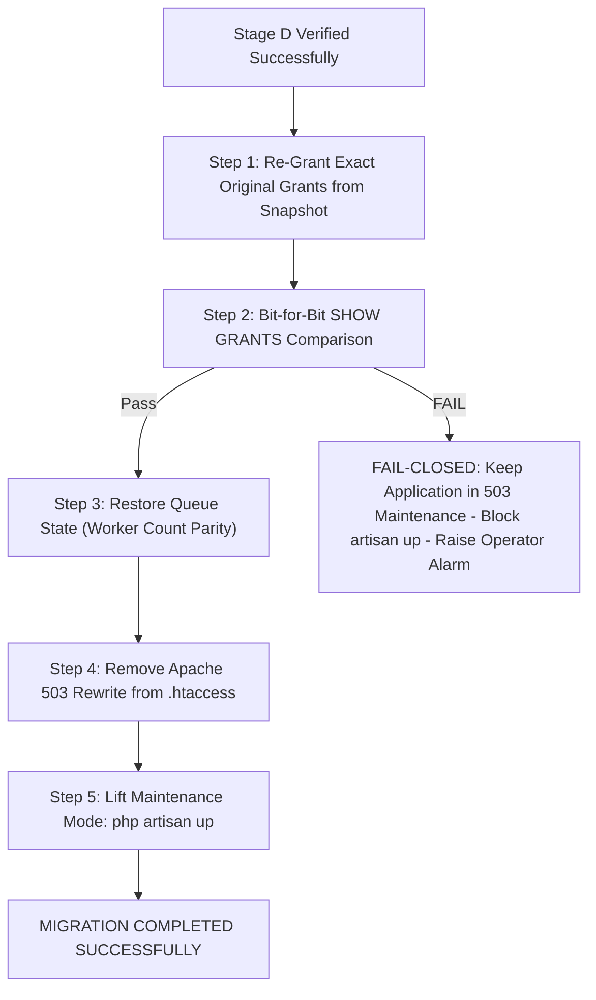

# PHASE 3O: FINAL PRODUCTION EXECUTION RUNBOOK (DEFECT-FREE & FAIL-CLOSED)

**Project:** MARSS Corporation Retail Management System → Dedicated Battery Module  
**Repository:** `marsscorp-retailshop-mgm`  
**Host Environment:** Windows Server / Win64, MySQL 8.4.3 Community Server (`127.0.0.1:3306`), PHP 8.3.30, Laravel 12.64.0  
**Production Database:** `marsscorpdb`  
**Target Module:** Dedicated Battery Module (`battery_*` tables)  
**Execution Command:** `php artisan battery:migrate-from-retail --force`  
**Lead Execution Operator:** Lead Backend Migration Engineer  
**Secondary Verifier / Authorization Authority:** Human Project Owner  
**Current Status:** **`HOLD — AWAITING EXPLICIT HUMAN AUTHORIZATION`**  

---

```
========================================================================================
                      MANDATORY OPERATIONAL GATEWAY                                     
========================================================================================
  STRICT PRODUCTION LOCK         : NO COMMAND IN THIS RUNBOOK SHALL BE EXECUTED 
                                   UNTIL THE HUMAN PROJECT OWNER ISSUES SEPARATE,
                                   EXPLICIT WRITTEN AUTHORIZATION IN CHAT.
  FAIL-CLOSED SAFETY POSTURE     : IF ANY RECOVERY GATE FAILS, APPLICATION MUST REMAIN
                                   IN HTTP 503 MAINTENANCE MODE. NEVER BRING ONLINE
                                   WITH BROKEN OR INCOMPLETE DATABASE PRIVILEGES.
  POST-COMMIT NON-ROLLBACK RULE  : ZERO AUTOMATIC ROLLBACK AFTER DATABASE COMMIT.
========================================================================================
```

---

## 1. Preconditions & Verification Gate ($T - 30\text{m}$)

| Check # | Verification Requirement | Verification Command / Method | Expected Passing State | Gate Status |
|:---:|:---|:---|:---:|:---:|
| **1.1** | Host Disk Storage | `Get-PSDrive -Name D` | Free Space $> 10\text{ GB}$ | [ ] REQUIRED |
| **1.2** | MySQL Server Status | `mysqladmin -h 127.0.0.1 -P 3306 -u root ping` | `mysqld is alive` | [ ] REQUIRED |
| **1.3** | Production Battery State | `php scratch/check_production_zero_rows.php` | All 21 battery tables = 0 rows | [ ] REQUIRED |
| **1.4** | Human Authorization | Chat transcript review | Explicit written approval received | [ ] BLOCKING |

---

## 2. Stage A: Multi-Tier Environmental Isolation ($T - 10\text{m}$)

### Step 2.1: Web Ingress Block (Web Server Level)
Deploy an immediate HTTP 503 rewrite rule in `public/.htaccess` to intercept and block all external HTTP traffic before reaching Laravel (completely eliminating secret cookie bypass):
```apache
# Insert at top of public/.htaccess
ErrorDocument 503 "MARSS CORPORATION: SCHEDULED DATABASE MIGRATION IN PROGRESS"
RewriteEngine On
RewriteRule .* - [R=503,L]
```

### Step 2.2: Queue Worker Drain & Elimination
Record initial worker count, pause queue, and terminate worker daemons:
```powershell
# 1. Record pre-state
$workers = Get-CimInstance Win32_Process | Where-Object { $_.CommandLine -like "*artisan*queue:work*" }
$initialWorkerCount = ($workers | Measure-Object).Count
@{ initial_worker_count = $initialWorkerCount; timestamp = (Get-Date).ToString("o") } | ConvertTo-Json | Set-Content "scratch/phase_3o/worker_prestate.json"

# 2. Pause queue in cache
php artisan queue:pause default

# 3. Graceful restart signal
php artisan queue:restart

# 4. Enforce process termination
Start-Sleep -Seconds 3
foreach ($w in (Get-CimInstance Win32_Process | Where-Object { $_.CommandLine -like "*artisan*queue:work*" })) {
    Stop-Process -Id $w.ProcessId -Force
}
```

### Step 2.3: Strict Application Maintenance Mode (No Secret Bypass)
```powershell
php artisan down --retry=60
```

### Step 2.4: Database Privilege Snapshot & Engine-Level Write Revocation
Capture baseline grants verbatim to JSON, then revoke application write permissions:
```sql
-- 1. Export verbatim grants snapshot for application user
SHOW GRANTS FOR 'marss_app'@'localhost';

-- 2. Revoke write capabilities
REVOKE INSERT, UPDATE, DELETE ON `marsscorpdb`.* FROM 'marss_app'@'localhost';
FLUSH PRIVILEGES;

-- 3. If Laravel is configured with root, lock account and execute migration under dedicated user:
-- ALTER USER 'root'@'localhost' ACCOUNT LOCK;
```

### Step 2.5: Active & Idle Session Drain
Terminate all foreign non-system sessions (including `Sleep` connections):
```powershell
php scratch/phase_3o/test_isolation_gate.php
```
Verify `SELECT COUNT(*) FROM information_schema.PROCESSLIST WHERE ID != CONNECTION_ID() AND USER != 'event_scheduler' AND COMMAND != 'Daemon'` is strictly **0**.

---

## 3. Stage B: Consistent Hot Backup & Deterministic Baseline ($T - 5\text{m}$)

### Step 3.1: Execute Native mysqldump
```powershell
$timestamp = Get-Date -Format 'yyyyMMdd_HHmmss'
$uuid = [guid]::NewGuid().ToString('N').Substring(0,8)
$backupPath = "d:\Running Works\04. Clients Back-end Projects - 2025\PHP - Laravel\MARSS Corp\marsscorp-retailshop-mgm\database\backups\prod_backup_${timestamp}_${uuid}.sql"

mysqldump --host=127.0.0.1 --port=3306 --user=root --single-transaction --quick --routines --triggers --events --result-file="$backupPath" marsscorpdb

if ($LASTEXITCODE -ne 0) {
    Write-Host "CRITICAL BACKUP FAILURE! Exit Code: $LASTEXITCODE" -ForegroundColor Red
    exit 1
}
```

### Step 3.2: Validate Backup Integrity
```powershell
$size = (Get-Item $backupPath).Length
$trailer = Get-Content $backupPath -Tail 5
if ($size -lt 100000 -or (-not ($trailer -match "Dump completed on"))) {
    Write-Host "CORRUPT BACKUP DETECTED! Aborting migration." -ForegroundColor Red
    exit 1
}
$backupHash = (Get-FileHash -Path $backupPath -Algorithm SHA256).Hash
Write-Host "Backup validated successfully. SHA-256: $backupHash"
```

### Step 3.3: Capture Pre-Migration Deterministic Source Hash ($T_{-0}$)
```powershell
php scratch/phase_3o/verify_deterministic_serialization.php
Copy-Item "scratch/phase_3o/deterministic_hashes_catalog.json" "scratch/phase_3o/pre_migration_hashes_$timestamp.json"
```

---

## 4. Stage C: Controlled Migration Execution ($T - 0$)

### Step 4.1: Final Writer Check
Confirm that only the Migration CLI session is active in MySQL.

### Step 4.2: Execute Migration Command
Execute using the dedicated least-privilege migration identity (or administrative identity):
```powershell
php artisan battery:migrate-from-retail --force 2>&1 | Tee-Object -FilePath "storage\logs\battery_migration_live_${timestamp}.log"
```

### Step 4.3: Verify Exit Code
Assert `$LASTEXITCODE -eq 0`. If non-zero, immediately trigger **Pre-Commit Rollback Handler**.

---

## 5. Stage D: Post-Migration Integrity & Source Parity Verification ($T + 2\text{m}$)

### Step 5.1: Destination Population Assertions
1. Verify all 21 `battery_*` tables populated with non-zero expected records.
2. Verify `battery_migration_mappings` row count matches total migrated entities.

### Step 5.2: Capture Post-Migration Source Hash ($T_{+0}$) & Bit-for-Bit Parity
```powershell
php scratch/phase_3o/verify_deterministic_serialization.php
Copy-Item "scratch/phase_3o/deterministic_hashes_catalog.json" "scratch/phase_3o/post_migration_hashes_$timestamp.json"
```
Compare `pre_migration_hashes` vs `post_migration_hashes`.  
**Assertion:** 15/15 source tables match 100% bit-for-bit.

### Step 5.3: Core Financial Reconciliation Assertions
* **Customer Riyaz (5):** previous due = ৳23,592, Order #53 due = ৳37,674 (Total ৳61,266).
* **Customer Ma Saleha (1):** Battery previous due = ৳0.00, Order #62 due = ৳94,500.00. Retail previous due remains ৳118,680.00 untouched.
* **Supplier Payable:** Polo Battery = ৳7,360, CK124 Purchase #15 = ৳108,000 (Total ৳115,360).
* **Product Stocks:** Benq (737) = 1 unit (`LEDGER-RECONSTRUCTED STOCK`), PTB-250 (568) = 0, AP-29 (736) = 0.

---

## 6. Stage E: Operational Restoration & Fail-Closed Gate ($T + 5\text{m}$)



### Step 6.1: Restore Database Privileges
Execute exact restoration commands from the pre-migration snapshot:
```sql
GRANT INSERT, UPDATE, DELETE ON `marsscorpdb`.* TO 'marss_app'@'localhost';
FLUSH PRIVILEGES;
-- If root was locked: ALTER USER 'root'@'localhost' ACCOUNT UNLOCK;
```

### Step 6.2: Validate Grant Parity (CRITICAL FAIL-CLOSED GATE)
Compare current `SHOW GRANTS` against pre-migration baseline JSON.
* **IF MATCH:** Proceed to Step 6.3.
* **IF MISMATCH / ERROR:** **ABORT RESTORATION IMMEDIATELY.** Application remains in 503 Maintenance Mode. Do NOT proceed to `artisan up`. Alert Lead Operator.

### Step 6.3: Restore Queue State
```powershell
php artisan queue:continue default
$prestate = Get-Content "scratch/phase_3o/worker_prestate.json" | ConvertFrom-Json
if ($prestate.initial_worker_count -gt 0) {
    # Respawn workers only if they were running initially
    Start-Process -FilePath "C:\laragon\bin\php\php-8.3.30-Win32-vs16-x64\php.exe" -ArgumentList "artisan queue:work --sleep=3 --tries=3" -WindowStyle Hidden
}
```

### Step 6.4: Remove Web Ingress Block
Remove the 503 rewrite block from `public/.htaccess`.

### Step 6.5: Lift Maintenance Mode
```powershell
php artisan up
```
Application is officially declared online.

---

## 7. Stop Conditions & Post-Commit Non-Rollback Protocol

### Stop Condition 1: Pre-Commit Abort (Failure in Stage A, B, or C before commit)
* MySQL transaction rolls back automatically.
* Zero battery rows created.
* Execute Stage E restoration steps in order (Privileges $\rightarrow$ Grants Check $\rightarrow$ Queue $\rightarrow$ Ingress $\rightarrow$ Maintenance lift).

### Stop Condition 2: Post-Commit Failure (Failure in Stage D verification)
* **STRICT PROHIBITION ON AUTOMATIC ROLLBACK.**
* Never execute truncate, drop, or delete scripts.
* Freeze system in Maintenance Mode (503).
* Preserve all log files, batch identifiers, and process traces.
* Require **Mandatory Human Operator Intervention** to evaluate reconciliation.

