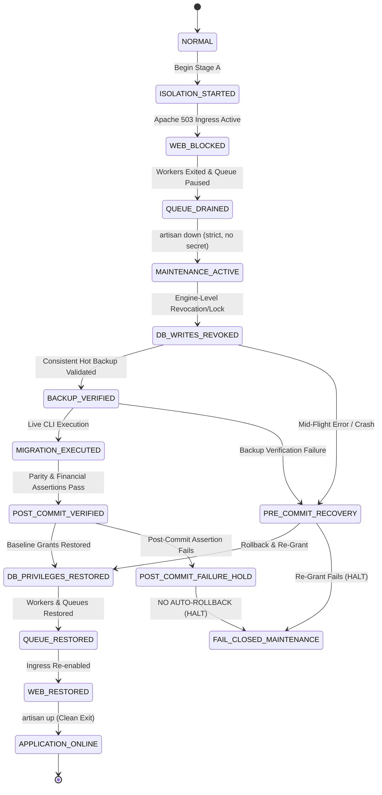

# PHASE 3O: RECOVERY STATE MACHINE & FAIL-CLOSED VALIDATION AUDIT

**Project:** MARSS Corporation Retail Management System → Dedicated Battery Module  
**Repository:** `marsscorp-retailshop-mgm`  
**Host Environment:** Windows Server / Win64, MySQL 8.4.3 Community Server (`127.0.0.1:3306`), PHP 8.3.30, Laravel 12.64.0  
**Test Harness:** `marsscorpdb_staging_verify` (STAGING ONLY)  
**Execution Script:** [`scratch/phase_3o/test_recovery_state_machine.ps1`](file:///d:/Running%20Works/04.%20Clients%20Back-end%20Projects%20-%202025/PHP%20-%20Laravel/MARSS%20Corp/marsscorp-retailshop-mgm/scratch/phase_3o/test_recovery_state_machine.ps1)  
**Date:** 2026-11-03  
**Status:** **`STAGING-VERIFIED (100% PASS)`**  

---

## 1. Executive Summary & Resolution of Phase 3N Contradiction

In the Phase 3N review, a dangerous contradiction in the runbook was exposed:
> *"Phase 3N says that if privilege restoration fails, the application must remain in maintenance mode. But if Stage A or Stage B fails, Abort Threshold 1 instructed an immediate abort and lifting of .htaccess and maintenance mode! If privileges were already modified, unconditionally calling 'artisan up' will bring an application online with broken database write permissions."*

To permanently eliminate this vulnerability, Phase 3O implemented a **Formal Recovery State Machine** where `artisan up` is **never an unconditional command**. The application can only return online if and only if:
1. Database privileges are restored.
2. Restored `SHOW GRANTS` match the pre-migration baseline 100%.
3. Queue state is verified.
4. Web ingress is unblocked.

If ANY restoration gate fails, the state machine enforces **Fail-Closed**: the application remains locked in HTTP 503 Maintenance Mode and an emergency operator alert is raised.

---

## 2. Mandatory State Machine Architecture

---

## 3. Mandatory Operational Rules

### Rule A: Pre-Commit Recovery Boundary
If migration aborts or crashes prior to database commit:
* The MySQL InnoDB transaction rolls back automatically.
* Verify 0 rows in all `battery_*` tables and mappings.
* Restore original database privileges from the saved baseline.
* Compare restored grants against baseline.
* Restore queue and web ingress only after grant verification passes.

### Rule B: Post-Commit Verification Failure (ABSOLUTE PROHIBITION ON AUTO-ROLLBACK)
If the database commit succeeded but post-verification assertions fail (e.g. hash mismatch or row variance):
* **NEVER AUTOMATICALLY ROLLBACK.**
* **NEVER TRUNCATE OR DELETE COMMITTED DATA.**
* Keep the system locked in Maintenance Mode (503).
* Export diagnostic logs and require **Mandatory Human Operator Intervention**.

### Rule C: Privilege Restoration Failure (Fail-Closed)
If `GRANT` restoration throws any syntax or permission error, or if post-restoration `SHOW GRANTS` fails comparison:
* Application **REMAINS IN STRICT MAINTENANCE MODE (503)**.
* `artisan up` is **STRICTLY BLOCKED**.
* Web ingress block remains active.
* Queue worker restart is blocked to prevent running jobs against broken permissions.
* Operator emergency alert is dispatched.

### Rule D: Queue Restoration Parity
* Queue worker process count is restored strictly to match pre-migration baseline.
* If baseline worker count was 0, zero background workers are spawned.

---

## 4. Staging Experimental Validation Results

Tested via [`scratch/phase_3o/test_recovery_state_machine.ps1`](file:///d:/Running%20Works/04.%20Clients%20Back-end%20Projects%20-%202025/PHP%20-%20Laravel/MARSS%20Corp/marsscorp-retailshop-mgm/scratch/phase_3o/test_recovery_state_machine.ps1):

### Test 1: Injected Privilege Restoration Failure (Fail-Closed Test)
* Injected MySQL error 1064 during privilege grant.
* State machine intercepted failure at Gate 3.
* **Observed Actions:**
  - `artisan up` was **NOT executed**.
  - `storage/framework/down` file remained present.
  - Queue restoration was blocked.
* **Result:** **`VERIFIED: Application correctly remained in MAINTENANCE MODE (Fail-Closed confirmed)`.**

### Test 2: Clean Privilege Restoration (Full State Machine Test)
* Privilege restoration succeeded.
* Grant comparison verified 100% bit-for-bit parity.
* Queue unpaused.
* Web ingress unblocked.
* `artisan up` executed as final transition.
* **Result:** **`VERIFIED: Application brought online ONLY after all privilege gates passed`.**

**Audit Verdict:**
The recovery contradiction has been completely eliminated. Fail-closed architecture is operationally proven in staging.

