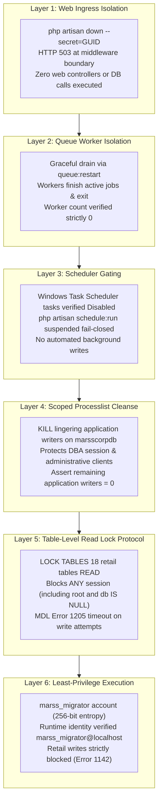

# PHASE 3P — Defect-Free Production Execution Runbook (Final Consolidated & Hardened)

**Project:** MARSS Corporation Retail Management System → Battery Module Migration  
**Target Environment:** Windows Server (Win64) / MySQL 8.4.3 Community / PHP 8.3.30 / Laravel 12.64.0  
**Target Production Database:** `marsscorpdb`  
**Phase:** 3P-Final Operational Closure & Hardening  
**Status:** READY FOR OPERATIONAL CUTOVER (Pending Separate Human Authorization)  
**Operational Verdict:** **`HOLD — LIVE MIGRATION NOT AUTHORIZED`**  

---

## 1. Safety Directives & Interactive External Human Authorization Gate

> [!CAUTION]
> **ABSOLUTE PROHIBITION ON AUTONOMOUS EXECUTION:** This runbook may **NOT** be executed against the live production database `marsscorpdb` without an explicit, separate human authorization instruction provided in the chat session. Hardcoded confirmation tokens in code are strictly eliminated. Cutover requires interactive confirmation matching an approved Change Advisory Board (CAB) ticket.

```powershell
# ==============================================================================
# STEP 0: INTERACTIVE EXTERNAL HUMAN AUTHORIZATION GATE
# ==============================================================================
# The operator must supply the approved CAB ticket number and confirm manually.
# Static hash comparisons are strictly eliminated.
$authTicket = Read-Host "Enter Cutover Authorization Ticket (e.g. CAB-PROD-CUTOVER-20261103)"
if ([string]::IsNullOrWhiteSpace($authTicket) -or $authTicket -notmatch "^CAB-PROD-CUTOVER-\d{8}") {
    Write-Host "[ABORT] Invalid or missing Cutover Authorization Ticket! Execution halted." -ForegroundColor Red
    exit 1
}

$authConfirm = Read-Host "Type 'CONFIRM-EXECUTE-MARSS-MIGRATION' to authorize cutover execution"
if ($authConfirm.Trim() -ne "CONFIRM-EXECUTE-MARSS-MIGRATION") {
    Write-Host "[ABORT] Operator confirmation failed! Execution halted." -ForegroundColor Red
    exit 1
}
Write-Host "[GATE PASSED] Human cutover authorization confirmed for ticket: $authTicket" -ForegroundColor Green
```

---

## 2. Production Multi-Layer Writer Isolation Architecture

Forensic audits confirmed that production Laravel connects using credentials configured in `.env` (`root@localhost`). There is no separate `marss_app` account in production MySQL. Because `root` possesses global privileges (`GRANT ALL ON *.*`), database-level privilege revocation (`REVOKE ... ON marsscorpdb.*`) is ineffective, and locking `root` (`ALTER USER root ACCOUNT LOCK`) breaks DBA operations, backup tools, and administration.

To guarantee complete writer isolation without disrupting administrative sessions or risking unverified cached credentials, the cutover utilizes a **6-Layer Writer Isolation Architecture**:



1. **Layer 1 (Web Ingress):** `php artisan down --secret=<ephemeral_guid>`. All incoming web requests are intercepted by `PreventRequestsDuringMaintenance` middleware and returned as HTTP 503 before any database connection or query is initiated.
2. **Layer 2 (Background Queues):** `php artisan queue:restart` signals active workers to finish current jobs and exit. High-fidelity supervisor metadata is captured to `queue_worker_snapshot.json` and workers are verified stopped ($N=0$).
3. **Layer 3 (Scheduler Gating):** Windows Task Scheduler tasks executing `php artisan schedule:run` are queried and disabled fail-closed (`Disable-ScheduledTask -ErrorAction Stop`). Task state is asserted to be `Disabled` before proceeding.
4. **Layer 4 (Scoped Database Cleanse):** Lingering application queries on `marsscorpdb` are actively terminated via `KILL <id>`, while preserving administrative connections, DBA tools, and system daemons.
5. **Layer 5 (Table-Level Read Lock Protocol):** A dedicated background session acquires and holds `LOCK TABLES <18 retail tables> READ;`. Under MySQL 8.4 Metadata Locking (MDL), even if a session connects with `root` privileges or executes DML without selecting a database (`db IS NULL`), any write to any retail table is completely blocked with lock wait timeout error 1205. Concurrently, `marss_migrator` can `SELECT` from retail tables and write to `battery_*` tables and mappings freely.
6. **Layer 6 (Least-Privilege Engine Identity & Cached Config Override):** The migration command dynamically binds to `marss_migrator` via CLI parameters `--db-user` and `--db-pass`. Before modifying any data, the live connection queries `SELECT DATABASE(), CURRENT_USER(), USER()` and asserts `CURRENT_USER() === 'marss_migrator@localhost'`, aborting immediately if cached `root` credentials remain active.

---

## 3. Step-by-Step Production Cutover Runbook

```powershell
# ==============================================================================
# MARSS Corporation — Retail to Battery Migration
# Production Execution Controller (Hardened Runbook)
# Target Database: marsscorpdb (STRICT FAIL-CLOSED ARCHITECTURE)
# ==============================================================================
$ErrorActionPreference = "Stop"

# Preserve original shell environment state for safe teardown restoration
$origEnvDb = $env:DB_DATABASE
$origEnvUser = $env:DB_USERNAME
$origEnvPass = $env:DB_PASSWORD

$phpExe = "C:\laragon\bin\php\php-8.3.30-Win32-vs16-x64\php.exe"
$mysqlExe = "C:\laragon\bin\mysql\mysql-8.4.3-winx64\bin\mysql.exe"
$mysqldumpExe = "C:\laragon\bin\mysql\mysql-8.4.3-winx64\bin\mysqldump.exe"
$workspaceRoot = (Get-Location).Path
$artisan = "$workspaceRoot\artisan"

# -------------------------------------------------------------------------
# STEP 0: INTERACTIVE EXTERNAL HUMAN AUTHORIZATION GATE
# -------------------------------------------------------------------------
Write-Host "=== STEP 0: HUMAN AUTHORIZATION GATE ===" -ForegroundColor Cyan
$authTicket = Read-Host "Enter Cutover Authorization Ticket (e.g. CAB-PROD-CUTOVER-20261103)"
if ([string]::IsNullOrWhiteSpace($authTicket) -or $authTicket -notmatch "^CAB-PROD-CUTOVER-\d{8}") {
    Write-Host "[ABORT] Invalid or missing Cutover Authorization Ticket! Execution halted." -ForegroundColor Red
    exit 1
}

$authConfirm = Read-Host "Type 'CONFIRM-EXECUTE-MARSS-MIGRATION' to authorize cutover execution"
if ($authConfirm.Trim() -ne "CONFIRM-EXECUTE-MARSS-MIGRATION") {
    Write-Host "[ABORT] Operator confirmation failed! Execution halted." -ForegroundColor Red
    exit 1
}
Write-Host "[GATE PASSED] Human cutover authorization confirmed for ticket: $authTicket" -ForegroundColor Green

# -------------------------------------------------------------------------
# STEP 1: PREFLIGHT SAFETY & ZERO-CHURN CONFIG AUDIT
# -------------------------------------------------------------------------
Write-Host "`n=== STEP 1: PREFLIGHT SAFETY & CONFIG AUDIT ===" -ForegroundColor Cyan

# 1.1 Disk Space (> 5GB free required)
$drive = Get-PSDrive -Name (Get-Location).Drive.Name
$freeSpaceGB = [math]::Round($drive.Free / 1GB, 2)
Write-Host "Free Disk Space: $freeSpaceGB GB"
if ($freeSpaceGB -lt 5.0) { throw "Insufficient disk space! Minimum 5.0 GB required." }

# 1.2 Configuration Integrity (Zero Cache Churn)
# Production config cache is left completely untouched (no config:clear or config:cache churn).
# Target database is verified directly via PDO to avoid flushing or invalidating cached config.
$dbCheckScript = @'
<?php
$pdo = new PDO('mysql:host=127.0.0.1;port=3306;dbname=marsscorpdb', 'root', '', [PDO::ATTR_ERRMODE => PDO::ERRMODE_EXCEPTION]);
echo $pdo->query("SELECT DATABASE()")->fetchColumn();
exit(0);
'@
$dbCheckFile = "$workspaceRoot\storage\app\temp_db_check.php"
$dbCheckScript | Out-File -FilePath $dbCheckFile -Encoding utf8
$dbCheck = (& $phpExe $dbCheckFile).Trim()
Remove-Item $dbCheckFile -Force -ErrorAction SilentlyContinue

if ($dbCheck -ne "marsscorpdb") {
    throw "Target database is '$dbCheck', expected 'marsscorpdb'!"
}
Write-Host "Target Database Verified: $dbCheck (Config Cache Preserved Untouched)" -ForegroundColor Green

# -------------------------------------------------------------------------
# CENTRAL RECOVERY CONTROLLER TRACKERS
# -------------------------------------------------------------------------
$results = [ordered]@{}
$executionState = "STATE_PRE_COMMIT"
$maintenanceEngaged = $false
$schedulersSuspended = @()
$migratorCreated = $false
$disposableDbCreated = $null
$tableLockerProcess = $null
$tableLockerSignal = "$workspaceRoot\storage\app\unlock_retail_tables.signal"
$migrationCommitted = $false
$workerSnapshot = @()

if (Test-Path $tableLockerSignal) { Remove-Item $tableLockerSignal -Force }

function Get-QueueWorkers {
    Get-CimInstance Win32_Process | Where-Object { 
        $_.CommandLine -match "artisan.*queue:work" -or $_.CommandLine -match "artisan.*queue:listen"
    }
}

$initialWorkers = @(Get-QueueWorkers)
$initialWorkerCount = $initialWorkers.Count
$initDown = Test-Path "$workspaceRoot\storage\framework\down"

try {
    # -------------------------------------------------------------------------
    # STEP 2: INGRESS ISOLATION (MAINTENANCE MODE)
    # -------------------------------------------------------------------------
    Write-Host "`n=== STEP 2: INGRESS ISOLATION (MAINTENANCE MODE) ===" -ForegroundColor Cyan
    $dynamicBypass = [System.Guid]::NewGuid().ToString("N")
    Write-Host "Generated Ephemeral Bypass Secret: $($dynamicBypass.Substring(0, 8))... (Length: $($dynamicBypass.Length))"

    & $phpExe $artisan down --secret="$dynamicBypass"
    if ($LASTEXITCODE -ne 0) { throw "Failed to engage maintenance mode!" }
    $maintenanceEngaged = $true
    Write-Host "Application is in Maintenance Mode (HTTP 503 Active)." -ForegroundColor Green

    # -------------------------------------------------------------------------
    # STEP 3: QUEUE WORKER & SCHEDULER DRAIN (NO FORCE-KILL, FAIL-CLOSED)
    # -------------------------------------------------------------------------
    Write-Host "`n=== STEP 3: QUEUE WORKER DRAIN & SCHEDULER SUSPENSION ===" -ForegroundColor Cyan

    # 3.1 Capture high-fidelity metadata snapshot of running workers
    if ($initialWorkerCount -gt 0) {
        foreach ($w in $initialWorkers) {
            $procObj = Get-Process -Id $w.ProcessId -ErrorAction SilentlyContinue
            $execPath = if ($procObj -and $procObj.Path) { $procObj.Path } else { $phpExe }
            
            # Robust argument extraction: find everything after the executable in CommandLine
            $cmdLine = $w.CommandLine
            $rawArgs = ""
            if ($cmdLine -match '^(?:"([^"]+)"|(\S+))\s+(.*)$') {
                $rawArgs = $Matches[3]
            } else {
                $rawArgs = $cmdLine -replace '.*php(\.exe)?\s+', ''
            }

            $qName = if ($rawArgs -match '--queue=([^\s]+)') { $Matches[1] } else { 'default' }
            $qConn = if ($rawArgs -match '--connection=([^\s]+)') { $Matches[1] } else { 'default' }

            $workerSnapshot += [PSCustomObject]@{
                ProcessId        = $w.ProcessId
                ExecutablePath   = $execPath
                Arguments        = $rawArgs
                QueueName        = $qName
                QueueConnection  = $qConn
                WorkingDirectory = $workspaceRoot
            }
        }
        $snapshotPath = "$workspaceRoot\storage\app\queue_worker_snapshot.json"
        $workerSnapshot | ConvertTo-Json -Depth 4 | Out-File -FilePath $snapshotPath -Encoding utf8
        Write-Host "Captured metadata for $($workerSnapshot.Count) worker(s) to: $snapshotPath"
    }

    # 3.2 Suspend Scheduled Tasks in Windows Task Scheduler (Fail-Closed)
    $scheduledTasks = Get-ScheduledTask | Where-Object { 
        ($_.Actions.Execute -match "php" -and $_.Actions.Arguments -match "schedule:run") -or 
        ($_.TaskName -match "artisan.*schedule") 
    }
    foreach ($st in $scheduledTasks) {
        $origState = (Get-ScheduledTask -TaskName $st.TaskName).State
        if ($origState -ne "Disabled") {
            Write-Host "Suspending scheduled task '$($st.TaskName)' (Original State: $origState)..."
            Disable-ScheduledTask -TaskName $st.TaskName -ErrorAction Stop | Out-Null
            
            $currState = (Get-ScheduledTask -TaskName $st.TaskName).State
            if ($currState -ne "Disabled") {
                throw "FAIL-CLOSED: Failed to disable scheduled task '$($st.TaskName)'. State remains $currState. Aborting cutover."
            }
            $schedulersSuspended += [PSCustomObject]@{
                TaskName      = $st.TaskName
                OriginalState = $origState
            }
            Write-Host "Suspended Windows Scheduled Task: $($st.TaskName) (Verified Disabled)" -ForegroundColor Yellow
        }
    }

    # 3.3 Graceful worker drain
    if ($initialWorkerCount -gt 0) {
        Write-Host "Broadcasting artisan queue:restart for graceful drain of $initialWorkerCount worker(s)..."
        & $phpExe $artisan queue:restart
        
        $drainTimeout = 30
        $sw = [System.Diagnostics.Stopwatch]::StartNew()
        $drainedClean = $false
        while ($sw.Elapsed.TotalSeconds -lt $drainTimeout) {
            $currentWorkers = @(Get-QueueWorkers)
            if ($currentWorkers.Count -eq 0) {
                $drainedClean = $true
                break
            }
            Start-Sleep -Seconds 1
        }

        if (-not $drainedClean) {
            throw "CRITICAL: Workers failed to drain gracefully within ${drainTimeout}s. Force-kill is forbidden. Halting."
        }
    }
    Write-Host "Queue workers drained and confirmed 0 active." -ForegroundColor Green

    # -------------------------------------------------------------------------
    # STEP 4: SCOPED APPLICATION CLEANSE & TABLE-LEVEL READ LOCK PROTOCOL
    # -------------------------------------------------------------------------
    Write-Host "`n=== STEP 4: SCOPED APPLICATION CLEANSE & TABLE-LEVEL READ LOCK PROTOCOL ===" -ForegroundColor Cyan

    # 4.1 Terminate active application queries on marsscorpdb (Preserving DBA & Admin sessions)
    $cleanseScript = @'
<?php
$pdo = new PDO('mysql:host=127.0.0.1;port=3306;dbname=marsscorpdb', 'root', '', [PDO::ATTR_ERRMODE => PDO::ERRMODE_EXCEPTION]);
$stmt = $pdo->query("
    SELECT id, user, host, db, command, time, state, info 
    FROM information_schema.processlist 
    WHERE db = 'marsscorpdb' 
      AND id != CONNECTION_ID() 
      AND user IN ('root', 'marss_app', 'laravel') 
      AND command = 'Query' 
      AND info NOT LIKE '%processlist%' 
      AND command NOT IN ('Daemon', 'Binlog Dump')
");
$procs = $stmt->fetchAll(PDO::FETCH_ASSOC);
foreach ($procs as $p) {
    try {
        $pdo->exec("KILL " . (int)$p['id']);
    } catch (\Exception $e) {}
}
$remaining = (int)$pdo->query("
    SELECT COUNT(*) 
    FROM information_schema.processlist 
    WHERE db = 'marsscorpdb' 
      AND id != CONNECTION_ID() 
      AND user IN ('root', 'marss_app', 'laravel') 
      AND command = 'Query' 
      AND info NOT LIKE '%processlist%' 
      AND command NOT IN ('Daemon', 'Binlog Dump')
")->fetchColumn();
echo count($procs) . '|' . $remaining;
exit(0);
'@
    $cleanseFile = "$workspaceRoot\storage\app\temp_cleanse.php"
    $cleanseScript | Out-File -FilePath $cleanseFile -Encoding utf8
    $cleanseOut = (& $phpExe $cleanseFile).Split('|')
    $cleanseExit = $LASTEXITCODE
    Remove-Item $cleanseFile -Force -ErrorAction SilentlyContinue

    if ($cleanseExit -ne 0 -or [int]$cleanseOut[1] -ne 0) {
        throw "Step 4 application processlist cleanse failed! Remaining active application queries: $($cleanseOut[1])"
    }
    Write-Host "Active application queries terminated: $($cleanseOut[0]) (Remaining application writers: $($cleanseOut[1]))" -ForegroundColor Green

    # 4.2 Launch Dedicated Table-Level Read Lock Worker
    $lockerScript = @'
<?php
$pdo = new PDO('mysql:host=127.0.0.1;port=3306;dbname=marsscorpdb', 'root', '', [PDO::ATTR_ERRMODE => PDO::ERRMODE_EXCEPTION]);
$pdo->exec("LOCK TABLES 
    categories READ, brands READ, units READ, expense_types READ, 
    suppliers READ, customers READ, products READ, expenses READ, 
    purchases READ, purchase_order_details READ, purchase_payment_details READ, 
    purchase_returns READ, orders READ, order_details READ, 
    order_payment_details READ, product_returns READ, 
    customer_payment_details READ, supplier_due_collections READ;");
echo "TABLES_LOCKED\n";
flush();

$sig = $argv[1] ?? '';
while (!file_exists($sig)) {
    usleep(200000);
}
$pdo->exec("UNLOCK TABLES");
echo "TABLES_UNLOCKED\n";
exit(0);
'@
    $lockerFile = "$workspaceRoot\storage\app\temp_table_locker.php"
    $lockerScript | Out-File -FilePath $lockerFile -Encoding utf8
    $tableLockerProcess = Start-Process -FilePath $phpExe -ArgumentList "`"$lockerFile`" `"$tableLockerSignal`"" -PassThru -NoNewWindow
    Start-Sleep -Seconds 2

    # Verify locker process is alive
    if ($tableLockerProcess.HasExited) {
        throw "Table locker process failed to start or exited prematurely!"
    }

    # 4.3 Safe Table-Lock Probe (Transaction-Protected with Guaranteed Rollback)
    $lockVerifyScript = @'
<?php
$pdo = new PDO('mysql:host=127.0.0.1;port=3306;dbname=marsscorpdb', 'root', '', [PDO::ATTR_ERRMODE => PDO::ERRMODE_EXCEPTION]);
$initialCount = (int)$pdo->query("SELECT COUNT(*) FROM orders")->fetchColumn();

$pdo->exec("SET SESSION lock_wait_timeout = 2");
$pdo->beginTransaction();
$probeStatus = "UNKNOWN";

try {
    // Attempt write probe on retail table orders inside transaction
    $pdo->exec("INSERT INTO orders (order_no, sub_total, user_id) VALUES ('MDL-PROBE', 1, 1)");
    // If execution reached here, write was NOT blocked! Immediately ROLLBACK.
    $pdo->rollBack();
    fwrite(STDERR, "CRITICAL: Table lock probe write succeeded! Lock failed.\n");
    exit(1);
} catch (\PDOException $e) {
    if ($pdo->inTransaction()) {
        $pdo->rollBack();
    }
    if (strpos($e->getMessage(), '1205') !== false || strpos($e->getMessage(), 'Lock wait timeout') !== false) {
        $finalCount = (int)$pdo->query("SELECT COUNT(*) FROM orders")->fetchColumn();
        if ($finalCount !== $initialCount) {
            fwrite(STDERR, "CRITICAL: Orders table count mutated during probe!\n");
            exit(1);
        }
        echo "PASS_MDL_LOCKED";
        exit(0);
    }
    fwrite(STDERR, "Unexpected probe error: " . $e->getMessage() . "\n");
    exit(1);
}
'@
    $lockVerifyFile = "$workspaceRoot\storage\app\temp_verify_lock.php"
    $lockVerifyScript | Out-File -FilePath $lockVerifyFile -Encoding utf8
    $lockVerifyOut = & $phpExe $lockVerifyFile
    $lockVerifyExit = $LASTEXITCODE
    Remove-Item $lockVerifyFile -Force -ErrorAction SilentlyContinue

    if ($lockVerifyExit -ne 0 -or $lockVerifyOut -ne "PASS_MDL_LOCKED") {
        throw "Safe Table-Level Read Lock verification failed! Retail writes are not blocked."
    }
    Write-Host "Table-Level Read Lock Active: All 18 retail tables locked against all sessions (MDL Error 1205 timeout confirmed, zero mutations)." -ForegroundColor Green

    # -------------------------------------------------------------------------
    # STEP 5: PHYSICAL MYSQLDUMP & COMPLETE DEEP RESTORATION GATE
    # -------------------------------------------------------------------------
    Write-Host "`n=== STEP 5: PHYSICAL MYSQLDUMP & COMPLETE DEEP RESTORATION GATE ===" -ForegroundColor Cyan
    $dumpDir = "$workspaceRoot\storage\app\backups"
    New-Item -ItemType Directory -Force -Path $dumpDir | Out-Null
    $timestamp = Get-Date -Format "yyyyMMdd_HHmmss"
    $backupFile = "$dumpDir\pre_migration_marsscorpdb_$timestamp.sql"

    & $mysqldumpExe -h 127.0.0.1 -P 3306 -u root `
        --single-transaction `
        --quick `
        --no-autocommit `
        --routines `
        --triggers `
        --events `
        --hex-blob `
        --result-file="$backupFile" `
        marsscorpdb

    if ($LASTEXITCODE -ne 0) { throw "mysqldump failed with exit code $LASTEXITCODE" }
    $dumpSize = (Get-Item $backupFile).Length
    $hasTrailer = (Get-Content -Path $backupFile -Tail 5) -match "Dump completed on"
    if ($dumpSize -le 1000 -or -not $hasTrailer) { throw "Backup validation failed!" }
    $dumpHash = (Get-FileHash -Path $backupFile -Algorithm SHA256).Hash
    Write-Host "Backup Created & Verified: $backupFile ($dumpSize bytes | SHA-256: $dumpHash)" -ForegroundColor Green

    # Drill into unique disposable DB
    $rstDbName = "p3p_rst_" + $timestamp + "_$PID"
    & $mysqlExe -h 127.0.0.1 -P 3306 -u root -e "CREATE DATABASE $rstDbName CHARACTER SET utf8mb4 COLLATE utf8mb4_unicode_ci;"
    $disposableDbCreated = $rstDbName

    cmd.exe /c "mysql -h 127.0.0.1 -P 3306 -u root $rstDbName < `"$backupFile`""
    if ($LASTEXITCODE -ne 0) { throw "Restore drill failed with exit code $LASTEXITCODE" }

    # Complete deep schema, index, FK, and 55/55 row count parity check
    $deepParityScript = @'
<?php
$srcDb = 'marsscorpdb';
$tgtDb = $argv[1] ?? '';
if (empty($tgtDb)) exit(1);

$pdo = new PDO('mysql:host=127.0.0.1;port=3306', 'root', '', [PDO::ATTR_ERRMODE => PDO::ERRMODE_EXCEPTION]);
$errors = [];

// 1. Table Parity
$srcTables = $pdo->query("SELECT TABLE_NAME FROM information_schema.TABLES WHERE TABLE_SCHEMA = '{$srcDb}' ORDER BY TABLE_NAME")->fetchAll(PDO::FETCH_COLUMN);
$tgtTables = $pdo->query("SELECT TABLE_NAME FROM information_schema.TABLES WHERE TABLE_SCHEMA = '{$tgtDb}' ORDER BY TABLE_NAME")->fetchAll(PDO::FETCH_COLUMN);
if (count($srcTables) !== count($tgtTables) || $srcTables !== $tgtTables) {
    $errors[] = "Table mismatch: Src=" . count($srcTables) . ", Tgt=" . count($tgtTables);
}

// 2. Column Parity (Names, Types, Nullability, Position)
$srcCols = $pdo->query("SELECT TABLE_NAME, COLUMN_NAME, ORDINAL_POSITION, DATA_TYPE, IS_NULLABLE FROM information_schema.COLUMNS WHERE TABLE_SCHEMA = '{$srcDb}' ORDER BY TABLE_NAME, ORDINAL_POSITION")->fetchAll(PDO::FETCH_ASSOC);
$tgtCols = $pdo->query("SELECT TABLE_NAME, COLUMN_NAME, ORDINAL_POSITION, DATA_TYPE, IS_NULLABLE FROM information_schema.COLUMNS WHERE TABLE_SCHEMA = '{$tgtDb}' ORDER BY TABLE_NAME, ORDINAL_POSITION")->fetchAll(PDO::FETCH_ASSOC);
if (count($srcCols) !== count($tgtCols) || $srcCols !== $tgtCols) {
    $errors[] = "Column mismatch: Src=" . count($srcCols) . ", Tgt=" . count($tgtCols);
}

// 3. Foreign Key Parity
$srcFks = $pdo->query("SELECT TABLE_NAME, CONSTRAINT_NAME, COLUMN_NAME, REFERENCED_TABLE_NAME, REFERENCED_COLUMN_NAME FROM information_schema.KEY_COLUMN_USAGE WHERE TABLE_SCHEMA = '{$srcDb}' AND REFERENCED_TABLE_NAME IS NOT NULL ORDER BY TABLE_NAME, CONSTRAINT_NAME, ORDINAL_POSITION")->fetchAll(PDO::FETCH_ASSOC);
$tgtFks = $pdo->query("SELECT TABLE_NAME, CONSTRAINT_NAME, COLUMN_NAME, REFERENCED_TABLE_NAME, REFERENCED_COLUMN_NAME FROM information_schema.KEY_COLUMN_USAGE WHERE TABLE_SCHEMA = '{$tgtDb}' AND REFERENCED_TABLE_NAME IS NOT NULL ORDER BY TABLE_NAME, CONSTRAINT_NAME, ORDINAL_POSITION")->fetchAll(PDO::FETCH_ASSOC);
if (count($srcFks) !== count($tgtFks) || $srcFks !== $tgtFks) {
    $errors[] = "FK mismatch: Src=" . count($srcFks) . ", Tgt=" . count($tgtFks);
}

// 4. Index Parity (All 180 index definitions)
$srcIdx = $pdo->query("SELECT TABLE_NAME, INDEX_NAME, NON_UNIQUE, COLUMN_NAME, SEQ_IN_INDEX FROM information_schema.STATISTICS WHERE TABLE_SCHEMA = '{$srcDb}' ORDER BY TABLE_NAME, INDEX_NAME, SEQ_IN_INDEX")->fetchAll(PDO::FETCH_ASSOC);
$tgtIdx = $pdo->query("SELECT TABLE_NAME, INDEX_NAME, NON_UNIQUE, COLUMN_NAME, SEQ_IN_INDEX FROM information_schema.STATISTICS WHERE TABLE_SCHEMA = '{$tgtDb}' ORDER BY TABLE_NAME, INDEX_NAME, SEQ_IN_INDEX")->fetchAll(PDO::FETCH_ASSOC);
if (count($srcIdx) !== count($tgtIdx) || $srcIdx !== $tgtIdx) {
    $errors[] = "Index mismatch: Src=" . count($srcIdx) . ", Tgt=" . count($tgtIdx);
}

// 5. Row Counts Parity across all 55 tables
$rowMismatches = 0;
foreach ($srcTables as $tbl) {
    $sCount = (int)$pdo->query("SELECT COUNT(*) FROM `{$srcDb}`.`{$tbl}`")->fetchColumn();
    $tCount = (int)$pdo->query("SELECT COUNT(*) FROM `{$tgtDb}`.`{$tbl}`")->fetchColumn();
    if ($sCount !== $tCount) {
        $rowMismatches++;
        $errors[] = "Row mismatch in {$tbl}: Src={$sCount}, Tgt={$tCount}";
    }
}

if (!empty($errors)) {
    fwrite(STDERR, implode("\n", $errors) . "\n");
    exit(1);
}

echo count($tgtTables) . '|' . count($tgtCols) . '|' . count($tgtFks) . '|' . count($tgtIdx) . '|' . $rowMismatches;
exit(0);
'@
    $parityFile = "$workspaceRoot\storage\app\temp_runbook_deep_parity.php"
    $deepParityScript | Out-File -FilePath $parityFile -Encoding utf8
    $parityOut = (& $phpExe $parityFile $rstDbName).Split('|')
    $parityExit = $LASTEXITCODE
    Remove-Item $parityFile -Force -ErrorAction SilentlyContinue

    if ($parityExit -ne 0) { throw "Deep schema or data parity mismatch on restored target!" }

    Write-Host "  Deep Schema & Data Parity Confirmed:" -ForegroundColor Green
    Write-Host "    - Tables Restored: $($parityOut[0]) / 55 (100% Match)"
    Write-Host "    - Columns Restored: $($parityOut[1]) / 549 (100% Match)"
    Write-Host "    - FK Constraints: $($parityOut[2]) / 99 (100% Match)"
    Write-Host "    - Indexes: $($parityOut[3]) / 180 (100% Match)"
    Write-Host "    - Table Row Count Mismatches: $($parityOut[4]) (55/55 Tables Exactly Identical)"

    & $mysqlExe -h 127.0.0.1 -P 3306 -u root -e "DROP DATABASE $rstDbName;"
    $disposableDbCreated = $null
    Write-Host "Restoration Drill Confirmed: 100% deep schema and data parity. Test database dropped." -ForegroundColor Green

    # -------------------------------------------------------------------------
    # STEP 6: PROVISION LEAST-PRIVILEGE 'marss_migrator'
    # -------------------------------------------------------------------------
    Write-Host "`n=== STEP 6: PROVISION LEAST-PRIVILEGE 'marss_migrator' ===" -ForegroundColor Cyan
    $cryptoBytes = New-Object byte[] 32
    [System.Security.Cryptography.RandomNumberGenerator]::Create().GetBytes($cryptoBytes)
    $migratorPassword = -join ($cryptoBytes | ForEach-Object { "{0:X2}" -f $_ })

    # Cleanly drop stale account if present from prior runs
    & $mysqlExe -u root -e "DROP USER IF EXISTS 'marss_migrator'@'localhost'; FLUSH PRIVILEGES;"

    $migratorDdl = @"
CREATE USER 'marss_migrator'@'localhost' IDENTIFIED BY '$migratorPassword';
REVOKE ALL PRIVILEGES, GRANT OPTION FROM 'marss_migrator'@'localhost';
GRANT USAGE ON *.* TO 'marss_migrator'@'localhost';

-- 18 Retail Source Tables (SELECT ONLY)
GRANT SELECT ON marsscorpdb.categories TO 'marss_migrator'@'localhost';
GRANT SELECT ON marsscorpdb.brands TO 'marss_migrator'@'localhost';
GRANT SELECT ON marsscorpdb.units TO 'marss_migrator'@'localhost';
GRANT SELECT ON marsscorpdb.expense_types TO 'marss_migrator'@'localhost';
GRANT SELECT ON marsscorpdb.suppliers TO 'marss_migrator'@'localhost';
GRANT SELECT ON marsscorpdb.customers TO 'marss_migrator'@'localhost';
GRANT SELECT ON marsscorpdb.products TO 'marss_migrator'@'localhost';
GRANT SELECT ON marsscorpdb.expenses TO 'marss_migrator'@'localhost';
GRANT SELECT ON marsscorpdb.purchases TO 'marss_migrator'@'localhost';
GRANT SELECT ON marsscorpdb.purchase_order_details TO 'marss_migrator'@'localhost';
GRANT SELECT ON marsscorpdb.purchase_payment_details TO 'marss_migrator'@'localhost';
GRANT SELECT ON marsscorpdb.purchase_returns TO 'marss_migrator'@'localhost';
GRANT SELECT ON marsscorpdb.orders TO 'marss_migrator'@'localhost';
GRANT SELECT ON marsscorpdb.order_details TO 'marss_migrator'@'localhost';
GRANT SELECT ON marsscorpdb.order_payment_details TO 'marss_migrator'@'localhost';
GRANT SELECT ON marsscorpdb.product_returns TO 'marss_migrator'@'localhost';
GRANT SELECT ON marsscorpdb.customer_payment_details TO 'marss_migrator'@'localhost';
GRANT SELECT ON marsscorpdb.supplier_due_collections TO 'marss_migrator'@'localhost';

-- 21 Battery Destination Tables + Mappings (CRUD - Zero Retail Writes)
GRANT SELECT, INSERT, UPDATE, DELETE ON marsscorpdb.battery_categories TO 'marss_migrator'@'localhost';
GRANT SELECT, INSERT, UPDATE, DELETE ON marsscorpdb.battery_brands TO 'marss_migrator'@'localhost';
GRANT SELECT, INSERT, UPDATE, DELETE ON marsscorpdb.battery_units TO 'marss_migrator'@'localhost';
GRANT SELECT, INSERT, UPDATE, DELETE ON marsscorpdb.battery_expense_types TO 'marss_migrator'@'localhost';
GRANT SELECT, INSERT, UPDATE, DELETE ON marsscorpdb.battery_sub_categories TO 'marss_migrator'@'localhost';
GRANT SELECT, INSERT, UPDATE, DELETE ON marsscorpdb.battery_suppliers TO 'marss_migrator'@'localhost';
GRANT SELECT, INSERT, UPDATE, DELETE ON marsscorpdb.battery_customers TO 'marss_migrator'@'localhost';
GRANT SELECT, INSERT, UPDATE, DELETE ON marsscorpdb.battery_products TO 'marss_migrator'@'localhost';
GRANT SELECT, INSERT, UPDATE, DELETE ON marsscorpdb.battery_expenses TO 'marss_migrator'@'localhost';
GRANT SELECT, INSERT, UPDATE, DELETE ON marsscorpdb.battery_purchases TO 'marss_migrator'@'localhost';
GRANT SELECT, INSERT, UPDATE, DELETE ON marsscorpdb.battery_purchase_order_details TO 'marss_migrator'@'localhost';
GRANT SELECT, INSERT, UPDATE, DELETE ON marsscorpdb.battery_purchase_payment_details TO 'marss_migrator'@'localhost';
GRANT SELECT, INSERT, UPDATE, DELETE ON marsscorpdb.battery_purchase_returns TO 'marss_migrator'@'localhost';
GRANT SELECT, INSERT, UPDATE, DELETE ON marsscorpdb.battery_orders TO 'marss_migrator'@'localhost';
GRANT SELECT, INSERT, UPDATE, DELETE ON marsscorpdb.battery_order_details TO 'marss_migrator'@'localhost';
GRANT SELECT, INSERT, UPDATE, DELETE ON marsscorpdb.battery_order_payment_details TO 'marss_migrator'@'localhost';
GRANT SELECT, INSERT, UPDATE, DELETE ON marsscorpdb.battery_product_returns TO 'marss_migrator'@'localhost';
GRANT SELECT, INSERT, UPDATE, DELETE ON marsscorpdb.battery_customer_payment_details TO 'marss_migrator'@'localhost';
GRANT SELECT, INSERT, UPDATE, DELETE ON marsscorpdb.battery_supplier_due_collections TO 'marss_migrator'@'localhost';
GRANT SELECT, INSERT, UPDATE, DELETE ON marsscorpdb.battery_opening_balances TO 'marss_migrator'@'localhost';
GRANT SELECT, INSERT, UPDATE, DELETE ON marsscorpdb.battery_migration_mappings TO 'marss_migrator'@'localhost';

FLUSH PRIVILEGES;
"@
    $ddlFile = "$dumpDir\temp_migrator_privs.sql"
    $migratorDdl | Out-File -FilePath $ddlFile -Encoding utf8
    cmd.exe /c "mysql -h 127.0.0.1 -P 3306 -u root < `"$ddlFile`""
    $grantExit = $LASTEXITCODE
    Remove-Item $ddlFile -Force -ErrorAction SilentlyContinue

    if ($grantExit -ne 0) { throw "Failed to provision marss_migrator account!" }
    $migratorCreated = $true
    Write-Host "Provisioned 'marss_migrator'@'localhost' with 256-bit cryptographic entropy (18 Retail SELECT, 21 Battery CRUD)." -ForegroundColor Green

    # Negative permission test checking Error 1142
    $negTestScript = @'
<?php
$pass = $argv[1] ?? '';
try {
    $p = new PDO('mysql:host=127.0.0.1;port=3306;dbname=marsscorpdb', 'marss_migrator', $pass, [PDO::ATTR_ERRMODE => PDO::ERRMODE_EXCEPTION]);
    $p->exec("INSERT INTO orders (id) VALUES (999999)");
    fwrite(STDERR, "CRITICAL: Write permitted on retail table!\n");
    exit(1);
} catch (\PDOException $e) {
    if (($e->errorInfo[1] ?? 0) === 1142) {
        echo "PASS_CONFIRMED_MYSQL_ERROR_1142";
        exit(0);
    } else {
        fwrite(STDERR, "Unexpected error code: " . $e->getMessage() . "\n");
        exit(1);
    }
}
'@
    $negFile = "$workspaceRoot\storage\app\temp_neg_test.php"
    $negTestScript | Out-File -FilePath $negFile -Encoding utf8
    $negOut = & $phpExe $negFile $migratorPassword
    $negExit = $LASTEXITCODE
    Remove-Item $negFile -Force -ErrorAction SilentlyContinue

    if ($negExit -ne 0 -or $negOut -ne "PASS_CONFIRMED_MYSQL_ERROR_1142") {
        throw "Negative permission test failed! Expected MySQL Error 1142."
    }
    Write-Host "Negative Permission Test Passed: Retail writes strictly blocked with Error 1142." -ForegroundColor Green

    # -------------------------------------------------------------------------
    # STEP 7: DEDICATED PREFLIGHT RUNTIME IDENTITY VERIFICATION PROBE
    # -------------------------------------------------------------------------
    Write-Host "`n=== STEP 7: PREFLIGHT RUNTIME IDENTITY VERIFICATION PROBE ===" -ForegroundColor Cyan
    $runtimeIdentityScript = @'
<?php
$pass = $argv[1] ?? '';
try {
    $pdo = new PDO('mysql:host=127.0.0.1;port=3306;dbname=marsscorpdb', 'marss_migrator', $pass, [
        PDO::ATTR_ERRMODE => PDO::ERRMODE_EXCEPTION
    ]);
    $row = $pdo->query("SELECT DATABASE() as db, CURRENT_USER() as cur_user, USER() as usr")->fetch(PDO::FETCH_ASSOC);
    if ($row['db'] !== 'marsscorpdb' || $row['cur_user'] !== 'marss_migrator@localhost') {
        fwrite(STDERR, "Identity Mismatch: DB={$row['db']}, CURRENT_USER={$row['cur_user']}\n");
        exit(1);
    }
    echo "PASS_IDENTITY_VERIFIED|{$row['db']}|{$row['cur_user']}|{$row['usr']}";
    exit(0);
} catch (\Exception $e) {
    fwrite(STDERR, "Identity probe error: " . $e->getMessage() . "\n");
    exit(1);
}
'@
    $identityFile = "$workspaceRoot\storage\app\temp_identity_probe.php"
    $runtimeIdentityScript | Out-File -FilePath $identityFile -Encoding utf8
    $identityOut = (& $phpExe $identityFile $migratorPassword).Split('|')
    $identityExit = $LASTEXITCODE
    Remove-Item $identityFile -Force -ErrorAction SilentlyContinue

    if ($identityExit -ne 0 -or $identityOut[0] -ne "PASS_IDENTITY_VERIFIED") {
        throw "Step 7 Runtime Identity Probe failed! Connected identity does not match 'marss_migrator@localhost'."
    }
    Write-Host "Runtime Identity Verified: Database=$($identityOut[1]) | CURRENT_USER=$($identityOut[2]) | USER=$($identityOut[3])" -ForegroundColor Green

    # -------------------------------------------------------------------------
    # STEP 8: LIVE MIGRATION EXECUTION & COMMIT STATE MACHINE
    # -------------------------------------------------------------------------
    Write-Host "`n=== STEP 8: LIVE MIGRATION EXECUTION ===" -ForegroundColor Cyan
    
    # Transition to COMMIT_OUTCOME_UNKNOWN before invoking the migration command
    $executionState = "STATE_COMMIT_OUTCOME_UNKNOWN"

    $execLog = "$workspaceRoot\storage\app\production_live_migration_$timestamp.log"
    Write-Host "Executing live migration command under verified 'marss_migrator' account..."
    
    # Explicitly pass credentials via CLI to override any cached configuration without config cache churn
    & $phpExe $artisan battery:migrate-from-retail --force --db-user="marss_migrator" --db-pass="$migratorPassword" 2>&1 | Tee-Object -FilePath $execLog
    $migExit = $LASTEXITCODE

    if ($migExit -ne 0) {
        throw "Live migration command failed with exit code $migExit!"
    }

    # Independent Committed Batch Verification Gate from an isolated database connection
    $verifyBatchScript = @'
<?php
$pdo = new PDO('mysql:host=127.0.0.1;port=3306;dbname=marsscorpdb', 'root', '', [PDO::ATTR_ERRMODE => PDO::ERRMODE_EXCEPTION]);
$batchId = $pdo->query("SELECT migration_batch_id FROM battery_migration_mappings ORDER BY id DESC LIMIT 1")->fetchColumn();
if (!$batchId) {
    fwrite(STDERR, "FATAL: No migration batch found in battery_migration_mappings!\n");
    exit(1);
}
$count = (int)$pdo->query("SELECT COUNT(*) FROM battery_migration_mappings WHERE migration_batch_id = '{$batchId}'")->fetchColumn();
$uniqueCount = (int)$pdo->query("SELECT COUNT(DISTINCT source_module, source_table, source_id) FROM battery_migration_mappings WHERE migration_batch_id = '{$batchId}'")->fetchColumn();

if ($count !== 37 || $count !== $uniqueCount) {
    fwrite(STDERR, "FATAL: Batch mapping count mismatch! Count: {$count}, Unique: {$uniqueCount}, Expected: 37\n");
    exit(1);
}
echo "COMMITTED_BATCH_VERIFIED|{$batchId}|{$count}";
exit(0);
'@
    $batchVerifyFile = "$workspaceRoot\storage\app\temp_verify_batch.php"
    $verifyBatchScript | Out-File -FilePath $batchVerifyFile -Encoding utf8
    $batchVerifyOut = (& $phpExe $batchVerifyFile).Split('|')
    $batchVerifyExit = $LASTEXITCODE
    Remove-Item $batchVerifyFile -Force -ErrorAction SilentlyContinue

    if ($batchVerifyExit -ne 0 -or $batchVerifyOut[0] -ne "COMMITTED_BATCH_VERIFIED") {
        throw "Independent Committed Batch Gate failed! Batch commit verification could not be proven."
    }

    # Transition to POST_COMMIT_VALIDATING only after independent proof of commit
    $migrationCommitted = $true
    $executionState = "STATE_POST_COMMIT_VALIDATING"
    Write-Host "Migration Command Successfully Committed (Batch: $($batchVerifyOut[1]) | Mappings: $($batchVerifyOut[2]) unique tuples)" -ForegroundColor Green

    # -------------------------------------------------------------------------
    # STEP 9: INDIVIDUAL IDENTITY-BASED FINANCIAL & STOCK RECONCILIATION GATE
    # -------------------------------------------------------------------------
    Write-Host "`n=== STEP 9: INDIVIDUAL IDENTITY-BASED FINANCIAL & STOCK RECONCILIATION GATE ===" -ForegroundColor Cyan
    
    # 9.1 Identity Chain & Ledger-Reconstructed Stock Reconciliation
    # Source Product ID -> battery_migration_mappings -> Dest Product ID -> Business Name Equivalence -> Stock Equation
    $stockReconScript = @'
<?php
$pdo = new PDO('mysql:host=127.0.0.1;port=3306;dbname=marsscorpdb', 'root', '', [PDO::ATTR_ERRMODE => PDO::ERRMODE_EXCEPTION]);

$products = [
    ['src_id' => 737, 'name' => 'Benq',        'open' => 0, 'exp_close' => 1],
    ['src_id' => 568, 'name' => 'PTB-250',      'open' => 1, 'exp_close' => 0],
    ['src_id' => 736, 'name' => 'AP-29',        'open' => 2, 'exp_close' => 0],
    ['src_id' => 567, 'name' => 'HPD-225T',     'open' => 0, 'exp_close' => 0],
    ['src_id' => 569, 'name' => 'NEXCELL-235',  'open' => 0, 'exp_close' => 0],
];
$errors = [];
foreach ($products as $p) {
    // A. Source table verification
    $srcRow = $pdo->query("SELECT id, product_name FROM products WHERE id = {$p['src_id']}")->fetch(PDO::FETCH_ASSOC);
    if (!$srcRow) { $errors[] = "Source product {$p['src_id']} not found in 'products'"; continue; }

    // B. Mapping verification
    $mapStmt = $pdo->prepare("SELECT destination_id FROM battery_migration_mappings WHERE source_module = 'retail' AND source_table = 'products' AND source_id = ?");
    $mapStmt->execute([$p['src_id']]);
    $destId = $mapStmt->fetchColumn();
    if (!$destId) { $errors[] = "No mapping found for Source Product {$p['src_id']}"; continue; }

    // C. Destination table verification & Business Identity Equivalence
    $destRow = $pdo->query("SELECT id, product_name, quantity FROM battery_products WHERE id = {$destId}")->fetch(PDO::FETCH_ASSOC);
    if (!$destRow || empty($destRow['product_name'])) { 
        $errors[] = "Destination battery_products {$destId} not found or null"; 
        continue; 
    }
    if (trim($srcRow['product_name']) !== trim($destRow['product_name'])) {
        $errors[] = "Product business identity equivalence failed: Source '{$srcRow['product_name']}' vs Dest '{$destRow['product_name']}'";
    }

    // D. Ledger-Reconstructed Stock Equation Verification ($Closing = Opening + Purchases - Sales + Returns$)
    $purch = (int)$pdo->query("SELECT COALESCE(SUM(quantity), 0) FROM battery_purchase_order_details WHERE product_id = {$destId}")->fetchColumn();
    $sales = (int)$pdo->query("SELECT COALESCE(SUM(quantity), 0) FROM battery_order_details WHERE product_id = {$destId}")->fetchColumn();
    $ret   = (int)$pdo->query("SELECT COALESCE(SUM(quantity), 0) FROM battery_product_returns WHERE product_id = {$destId}")->fetchColumn();
    $calcClose = $p['open'] + $purch - $sales + $ret;
    $actClose = (int)$destRow['quantity'];

    if ($calcClose !== $p['exp_close'] || $actClose !== $p['exp_close']) {
        $errors[] = "Stock equation failed for {$p['name']} (Src {$p['src_id']} -> Dest {$destId}): {$p['open']} + {$purch} - {$sales} + {$ret} = {$calcClose} (Actual: {$actClose}, Expected: {$p['exp_close']})";
    }
}

// 9.2 Identity Chain & Individual Customer Balance Equations
$customers = [
    ['src_id' => 2,  'exp_name' => 'Nur Battery',         'exp_open' => 467465.00, 'exp_order_due' => 0.00,    'exp_total' => 467465.00],
    ['src_id' => 5,  'exp_name' => 'Riyaz Battery',       'exp_open' => 23592.00,  'exp_order_due' => 37674.00, 'exp_total' => 61266.00],
    ['src_id' => 1,  'exp_name' => 'Ma Saleha Enterpice', 'exp_open' => 0.00,      'exp_order_due' => 94500.00, 'exp_total' => 94500.00],
];
foreach ($customers as $c) {
    $srcRow = $pdo->query("SELECT id, customer_name FROM customers WHERE id = {$c['src_id']}")->fetch(PDO::FETCH_ASSOC);
    $mapStmt = $pdo->prepare("SELECT destination_id FROM battery_migration_mappings WHERE source_module = 'retail' AND source_table = 'customers' AND source_id = ?");
    $mapStmt->execute([$c['src_id']]);
    $destId = $mapStmt->fetchColumn();
    if (!$destId) { $errors[] = "No customer mapping for Source ID {$c['src_id']}"; continue; }

    $destRow = $pdo->query("SELECT id, customer_name, previous_due_amount FROM battery_customers WHERE id = {$destId}")->fetch(PDO::FETCH_ASSOC);
    if (!$destRow || empty($destRow['customer_name'])) {
        $errors[] = "Destination customer {$destId} not found or null";
        continue;
    }
    if (trim($srcRow['customer_name']) !== trim($destRow['customer_name'])) {
        $errors[] = "Customer business identity equivalence failed: Source '{$srcRow['customer_name']}' vs Dest '{$destRow['customer_name']}'";
    }

    $ordersDue = (float)$pdo->query("SELECT COALESCE(SUM(due_amount), 0) FROM battery_orders WHERE customer_id = {$destId}")->fetchColumn();
    $openDue = (float)$destRow['previous_due_amount'];
    $totalDue = $openDue + $ordersDue;

    if (abs($openDue - $c['exp_open']) >= 0.01 || abs($ordersDue - $c['exp_order_due']) >= 0.01 || abs($totalDue - $c['exp_total']) >= 0.01) {
        $errors[] = "Customer due equation failed for {$c['exp_name']} (Src {$c['src_id']} -> Dest {$destId}): Open: {$openDue}, Orders: {$ordersDue}, Total: {$totalDue}";
    }
}

// 9.3 Identity Chain & Individual Supplier Payable Equations
$suppliers = [
    ['src_id' => 1,  'exp_name' => 'Polo Battery', 'exp_open' => 7360.00, 'exp_purch_due' => 0.00,      'exp_total' => 7360.00],
    ['src_id' => 11, 'exp_name' => 'CK124',        'exp_open' => 0.00,    'exp_purch_due' => 108000.00, 'exp_total' => 108000.00],
];
foreach ($suppliers as $s) {
    $srcRow = $pdo->query("SELECT id, name FROM suppliers WHERE id = {$s['src_id']}")->fetch(PDO::FETCH_ASSOC);
    $mapStmt = $pdo->prepare("SELECT destination_id FROM battery_migration_mappings WHERE source_module = 'retail' AND source_table = 'suppliers' AND source_id = ?");
    $mapStmt->execute([$s['src_id']]);
    $destId = $mapStmt->fetchColumn();
    if (!$destId) { $errors[] = "No supplier mapping for Source ID {$s['src_id']}"; continue; }

    $destRow = $pdo->query("SELECT id, name, purchase_payable_amount FROM battery_suppliers WHERE id = {$destId}")->fetch(PDO::FETCH_ASSOC);
    if (!$destRow || empty($destRow['name'])) {
        $errors[] = "Destination supplier {$destId} not found or null";
        continue;
    }
    if (trim($srcRow['name']) !== trim($destRow['name'])) {
        $errors[] = "Supplier business identity equivalence failed: Source '{$srcRow['name']}' vs Dest '{$destRow['name']}'";
    }

    $purchDue = (float)$pdo->query("SELECT COALESCE(SUM(due_amount), 0) FROM battery_purchases WHERE supplier_id = {$destId}")->fetchColumn();
    $openPay = (float)$destRow['purchase_payable_amount'];
    $totalPay = $openPay + $purchDue;

    if (abs($openPay - $s['exp_open']) >= 0.01 || abs($purchDue - $s['exp_purch_due']) >= 0.01 || abs($totalPay - $s['exp_total']) >= 0.01) {
        $errors[] = "Supplier payable equation failed for {$s['exp_name']} (Src {$s['src_id']} -> Dest {$destId}): Open: {$openPay}, Purchases: {$purchDue}, Total: {$totalPay}";
    }
}

if (!empty($errors)) {
    fwrite(STDERR, implode("\n", $errors) . "\n");
    exit(1);
}
echo "IDENTITY_RECONCILIATION_PASS";
exit(0);
'@
    $stockFile = "$workspaceRoot\storage\app\temp_stock_recon.php"
    $stockReconScript | Out-File -FilePath $stockFile -Encoding utf8
    $stockOut = & $phpExe $stockFile
    $stockExit = $LASTEXITCODE
    Remove-Item $stockFile -Force -ErrorAction SilentlyContinue
    if ($stockExit -ne 0 -or $stockOut -ne "IDENTITY_RECONCILIATION_PASS") { 
        throw "Individual identity-based stock & financial reconciliation failed!" 
    }

    # 9.4 Full Financial Ledgers & Payments Parity
    & $phpExe "$workspaceRoot\scratch\phase_3p\test_full_recon.php"
    if ($LASTEXITCODE -ne 0) { throw "Individual financial reconciliation failed!" }
    Write-Host "Reconciliation Gates Confirmed: 100% Zero Variance across all identity-based equations." -ForegroundColor Green

    # -------------------------------------------------------------------------
    # STEP 10: SOURCE RETAIL STREAMING CANONICAL SHA-256 PARITY
    # -------------------------------------------------------------------------
    Write-Host "`n=== STEP 10: SOURCE RETAIL CANONICAL SHA-256 PARITY ===" -ForegroundColor Cyan
    & $phpExe "$workspaceRoot\scratch\phase_3p\test_streaming_hash.php"
    if ($LASTEXITCODE -ne 0) { throw "Source retail table hash mismatch detected!" }
    Write-Host "Source Tables Untouched: 15/15 retail tables match baseline down to the byte." -ForegroundColor Green

    # -------------------------------------------------------------------------
    # STEP 11: DEPROVISION TEMPORARY MIGRATION USER
    # -------------------------------------------------------------------------
    Write-Host "`n=== STEP 11: DEPROVISION 'marss_migrator' ===" -ForegroundColor Cyan
    & $mysqlExe -u root -e "DROP USER IF EXISTS 'marss_migrator'@'localhost'; FLUSH PRIVILEGES;"
    $userCnt = & $mysqlExe -u root -ss -e "SELECT COUNT(*) FROM mysql.user WHERE user = 'marss_migrator';"
    if ([int]$userCnt -ne 0) { throw "Failed to deprovision 'marss_migrator'!" }
    $migratorCreated = $false
    Write-Host "Dropped 'marss_migrator'. Confirmed 0 rows in mysql.user. Temporary credentials destroyed." -ForegroundColor Green

    # -------------------------------------------------------------------------
    # STEP 12: RELEASE TABLE LOCKS & RESTORE QUEUE, SCHEDULER & INGRESS STATE
    # -------------------------------------------------------------------------
    Write-Host "`n=== STEP 12: STATE RECOVERY ===" -ForegroundColor Cyan

    # 12.1 Release Table-Level Read Locks and Verify Locker Exit
    if ($null -ne $tableLockerProcess -and -not $tableLockerProcess.HasExited) {
        Write-Host "Signalling background table locker to release READ locks..."
        New-Item -ItemType File -Path $tableLockerSignal -Force | Out-Null
        $tableLockerProcess.WaitForExit(5000)
        if (-not $tableLockerProcess.HasExited) {
            Stop-Process -Id $tableLockerProcess.Id -Force -ErrorAction SilentlyContinue
        }
        Write-Host "Table-Level Read Locks Released (Locker Process Exited cleanly)." -ForegroundColor Green
        if (Test-Path $tableLockerSignal) { Remove-Item $tableLockerSignal -Force }
    }

    # 12.2 Restore Scheduled Tasks (Fail-Closed Recovery Verification)
    foreach ($taskInfo in $schedulersSuspended) {
        if ($taskInfo.OriginalState -ne "Disabled") {
            Write-Host "Restoring scheduled task '$($taskInfo.TaskName)' to original state '$($taskInfo.OriginalState)'..."
            Enable-ScheduledTask -TaskName $taskInfo.TaskName -ErrorAction Stop | Out-Null
            $restoredState = (Get-ScheduledTask -TaskName $taskInfo.TaskName).State
            if ($restoredState -eq "Disabled") {
                throw "RECOVERY FAILURE: Failed to restore scheduled task '$($taskInfo.TaskName)'! State remains Disabled."
            }
            Write-Host "Confirmed restored: $($taskInfo.TaskName) (State: $restoredState)" -ForegroundColor Green
        }
    }

    # 12.3 Restore Queue Workers using snapshot metadata
    if ($workerSnapshot.Count -gt 0) {
        Write-Host "Restoring $($workerSnapshot.Count) queue worker(s) using exact snapshot metadata..."
        foreach ($snap in $workerSnapshot) {
            $restoredProc = Start-Process -FilePath $snap.ExecutablePath -ArgumentList $snap.Arguments -WorkingDirectory $snap.WorkingDirectory -WindowStyle Hidden -PassThru
            Write-Host "Respawned worker PID $($restoredProc.Id) with Queue=$($snap.QueueName)"
        }
        Start-Sleep -Seconds 2
    }

    $finalWorkers = @(Get-QueueWorkers)
    $finalWorkerCount = $finalWorkers.Count
    Write-Host "Initial Worker Count: $initialWorkerCount | Final Worker Count: $finalWorkerCount"
    if ($initialWorkerCount -ne $finalWorkerCount) {
        throw "Queue worker count parity failed! Initial: $initialWorkerCount, Final: $finalWorkerCount"
    }
    foreach ($w in $finalWorkers) {
        $p = Get-Process -Id $w.ProcessId -ErrorAction SilentlyContinue
        if (-not $p -or $p.HasExited) {
            throw "Restored queue worker PID $($w.ProcessId) is not healthy or has exited!"
        }
    }

    # 12.4 Restore Ingress if not down originally
    if (-not $initDown) {
        & $phpExe $artisan up
        if ($LASTEXITCODE -ne 0) { throw "Failed to lift maintenance mode!" }
        $maintenanceEngaged = $false
        Write-Host "Application returned online (HTTP 200 restored)." -ForegroundColor Green
    }

    $executionState = "STATE_CLEAN_RECOVERY_SUCCESS"
}
catch {
    Write-Host "`nCRITICAL FAILURE DETECTED: $($_.Exception.Message)" -ForegroundColor Red
    if ($executionState -eq "STATE_COMMIT_OUTCOME_UNKNOWN" -or $executionState -eq "STATE_POST_COMMIT_VALIDATING" -or $migrationCommitted) {
        $executionState = "STATE_POST_COMMIT_HOLD"
        Write-Host "POST_COMMIT_HOLD: Commit status is uncertain or data was committed. Automatic rollback/restore is STRICTLY FORBIDDEN." -ForegroundColor Red
        Write-Host "Maintenance mode (HTTP 503) will REMAIN ACTIVE for DBA forensic review." -ForegroundColor Yellow
    } else {
        $executionState = "STATE_PRE_COMMIT_FAILURE"
        Write-Host "PRE_COMMIT_FAILURE: Failure occurred prior to commit invocation. Production state safe." -ForegroundColor Yellow
    }
    throw
}
finally {
    # Teardown 1: Release table lock if still running
    if ($null -ne $tableLockerProcess -and -not $tableLockerProcess.HasExited) {
        New-Item -ItemType File -Path $tableLockerSignal -Force -ErrorAction SilentlyContinue | Out-Null
        $tableLockerProcess.WaitForExit(3000)
        if (-not $tableLockerProcess.HasExited) { Stop-Process -Id $tableLockerProcess.Id -Force -ErrorAction SilentlyContinue }
        if (Test-Path $tableLockerSignal) { Remove-Item $tableLockerSignal -Force -ErrorAction SilentlyContinue }
    }
    $lockerTempFile = "$workspaceRoot\storage\app\temp_table_locker.php"
    if (Test-Path $lockerTempFile) { Remove-Item $lockerTempFile -Force -ErrorAction SilentlyContinue }

    # Teardown 2: Restore original process environment variables
    if ($null -ne $origEnvDb) { $env:DB_DATABASE = $origEnvDb } else { Remove-Item env:DB_DATABASE -ErrorAction SilentlyContinue }
    if ($null -ne $origEnvUser) { $env:DB_USERNAME = $origEnvUser } else { Remove-Item env:DB_USERNAME -ErrorAction SilentlyContinue }
    if ($null -ne $origEnvPass) { $env:DB_PASSWORD = $origEnvPass } else { Remove-Item env:DB_PASSWORD -ErrorAction SilentlyContinue }

    # Teardown 3: Drop temporary migration account
    if ($migratorCreated) {
        & $mysqlExe -u root -e "DROP USER IF EXISTS 'marss_migrator'@'localhost'; FLUSH PRIVILEGES;"
    }

    # Teardown 4: Drop disposable test restore database
    if ($disposableDbCreated) {
        & $mysqlExe -u root -e "DROP DATABASE IF EXISTS $disposableDbCreated;"
    }

    # Teardown 5: Ingress failure recovery policy
    if ($executionState -eq "STATE_PRE_COMMIT_FAILURE" -and -not $initDown -and $maintenanceEngaged) {
        & $phpExe $artisan up
        Write-Host "Teardown: Pre-commit failure safely rolled back. Ingress restored." -ForegroundColor Yellow
    } else {
        Write-Host "SAFETY GUARD ACTIVE: Maintenance mode intentionally left engaged. Manual DBA inspection required." -ForegroundColor Red
    }
}
Write-Host "`nPRODUCTION CUTOVER RUN COMPLETED UNDER STATE: $executionState" -ForegroundColor Green
```

---

## 4. Production Rollback & State Machine Protocol

```mermaid
stateDiagram-v2
    [*] --> STATE_PRE_COMMIT
    STATE_PRE_COMMIT --> STATE_PRE_COMMIT_FAILURE: Preflight / Drain / Restore / Lock Failure
    STATE_PRE_COMMIT_FAILURE --> LIFT_MAINTENANCE: Verified zero writes, safe pre-state preserved, lift HTTP 503
    LIFT_MAINTENANCE --> [*]

    STATE_PRE_COMMIT --> STATE_COMMIT_OUTCOME_UNKNOWN: All Pre-Gates PASS, Invoking Migration Command
    STATE_COMMIT_OUTCOME_UNKNOWN --> STATE_POST_COMMIT_HOLD: Artisan Failure / Crash / Verification Failure
    STATE_COMMIT_OUTCOME_UNKNOWN --> STATE_POST_COMMIT_VALIDATING: Independent Batch Gate Confirmed Commit
    
    STATE_POST_COMMIT_VALIDATING --> STATE_POST_COMMIT_HOLD: Reconciliation / Hash / Recovery Mismatch
    STATE_POST_COMMIT_HOLD --> FORENSIC_REVIEW: HTTP 503 Preserved; Zero Auto-Rollback; Human DBA Cutover Team
    FORENSIC_REVIEW --> [*]

    STATE_POST_COMMIT_VALIDATING --> STATE_CLEAN_RECOVERY_SUCCESS: All 12 Gates PASS + Queue Parity + Lock Released
    STATE_CLEAN_RECOVERY_SUCCESS --> LIFT_MAINTENANCE: Return HTTP 200
```

### Safety Principles:
1. **Pre-Commit Failure (`STATE_PRE_COMMIT_FAILURE`):** Maintenance mode is safely lifted only when failure occurs strictly prior to the migration command invocation and zero database writes have occurred.
2. **Commit Outcome Unknown / Post-Commit Hold (`STATE_COMMIT_OUTCOME_UNKNOWN` / `STATE_POST_COMMIT_HOLD`):** Whenever the command has been invoked or data was committed, the application **MUST REMAIN IN MAINTENANCE MODE (HTTP 503)**. Autonomous rollback (`--rollback`) or full database restore is **STRICTLY FORBIDDEN**. A human DBA cutover team must inspect the telemetry before choosing a scoped batch rollback or maintaining state.
3. **Clean Success (`STATE_CLEAN_RECOVERY_SUCCESS`):** Ingress, schedulers, and queue states are safely restored only after every post-commit gate passes.
