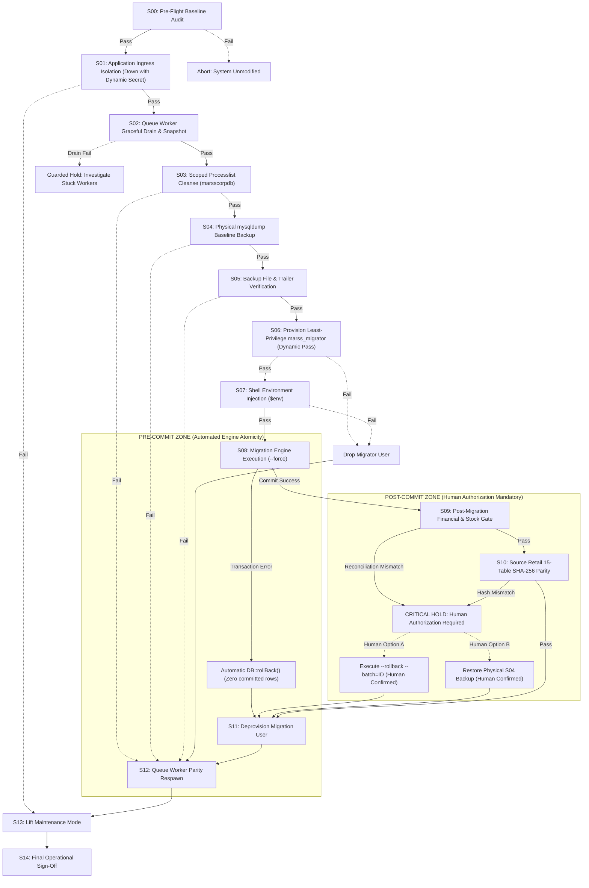

# PHASE 3P — Final Recovery State Machine & Abort Protocol (Final Corrected)

**Project:** MARSS Corporation Retail Management System → Battery Module Migration  
**Target Environment:** Windows Server / MySQL 8.4.3 / PHP 8.3.30 / Laravel 12.64.0  
**Phase:** 3P — Final Operational Closure  
**Status:** COMPLETE & VERIFIED  

---

## 1. Executive Summary

A mission-critical data migration requires a formal, mathematically deterministic state machine. A crucial operational requirement is the **strict separation between Pre-Commit Failure and Post-Commit Failure**:
1. **Pre-Commit Failure (before transaction commits):** Automated, atomic InnoDB engine rollback (`DB::rollBack()`). Zero rows are committed to `battery_*` tables. Automated cleanup safely returns the environment to baseline without human intervention.
2. **Post-Commit Failure (after transaction commits):** If post-migration reconciliation (S11) or retail hash check (S12) fails, automated rollback is **strictly prohibited**. The state machine enters `STATE_HOLD_FOR_HUMAN_INTERVENTION`. The operator is presented with the discrepancy and must explicitly authorize either a batch-scoped rollback or a full database restore from the pre-migration backup.

---

## 2. Mermaid State Transition Diagram



---

## 3. The Detailed State Specifications

| State ID | State Name | Execution Guard | Action Performed | Success Criteria | Abort / Failure Transition |
| :---: | :--- | :--- | :--- | :--- | :--- |
| **S00** | **Pre-Flight Baseline Audit** | Human authorization token verified | Disk space $> 5\text{GB}$, target DB guard | All assertions true | Halt. System pristine. |
| **S01** | **Ingress Isolation** | S00 PASS | `artisan down --secret=<GUID>` | HTTP 503 active | S13 (artisan up) |
| **S02** | **Queue Worker Graceful Drain** | S01 PASS | Capture metadata; `artisan queue:restart` | Active workers $== 0$ within 30s | Guarded Hold; alert operator (do not blindly artisan up) |
| **S03** | **Scoped Processlist Cleanse** | S02 PASS | `KILL` sessions where `db = 'marsscorpdb'` and `id != CONNECTION_ID()` | Zero retail queries running | S12 (Restart workers), S13 |
| **S04** | **Physical Backup Execution** | S03 PASS | Native `mysqldump --single-transaction --result-file=...` | Process exit code 0 | S12, S13 |
| **S05** | **Backup Validation** | S04 PASS | Filesize $>1000\text{B}$, trailer check, SHA-256 | Dump integrity verified | Delete incomplete dump; S12, S13 |
| **S06** | **Migration User Setup** | S05 PASS | Create `marss_migrator` with dynamic 32-char password; 18 Retail `SELECT` + 21 Battery CRUD | Privileges active; retail writes blocked (Error 1142) | Drop migrator; S12, S13 |
| **S07** | **Shell Env Injection** | S06 PASS | Set `$env:DB_USERNAME = 'marss_migrator'`, `$env:DB_PASSWORD = $pass` | `CURRENT_USER()` reports `marss_migrator` | Clear env; drop migrator; S12, S13 |
| **S08** | **Live Migration Run** | S07 PASS | `php artisan battery:migrate-from-retail --force` | Exit code 0; Batch ID logged | **PRE-COMMIT FAILURE:** Engine rolls back atomically; S11, S12, S13 |
| **S09** | **Financial Reconciliation** | S08 Commit PASS | Assert: Customer Due ৳623,231; Supplier ৳115,360; Benq 1; PTB/AP 0 | Equations match with zero variance | **POST-COMMIT FAILURE:** Enter Guarded Hold (Human Authorization Mandatory) |
| **S10** | **Source Parity Audit** | S09 PASS | Re-calculate canonical SHA-256 for 15 source retail tables | Baseline hashes $\equiv$ Post hashes | **POST-COMMIT FAILURE:** Enter Guarded Hold (Human Authorization Mandatory) |
| **S11** | **Migrator Deprovision** | S10 PASS | Drop user `marss_migrator@localhost`; clear shell env | User dropped; credentials purged | Log warning; proceed to S12 |
| **S12** | **Queue Worker Parity** | S11 PASS | Loop $1..N$ on snapshot; spawn identical workers with arguments | Active workers count $== N$ | Log discrepancy; alert Ops |
| **S13** | **Lift Ingress Isolation** | S12 PASS | `php artisan up` | HTTP 200 restored | Retry `php artisan up` |
| **S14** | **Final Operational Sign-Off** | S13 PASS | Record audit report, SHA-256 hashes, batch run log | All gates verified | Migration Live in Production |

---

## 4. Pre-Commit vs Post-Commit Disaster Recovery Matrix

```
+------------------------------------+-----------------------+-------------------------------------------------------------+
| Failure Stage                      | Failure Regime        | Mandatory Recovery Protocol                                 |
+------------------------------------+-----------------------+-------------------------------------------------------------+
| S01 - S03 (Ingress / Drain)        | Pre-Execution         | S12 (Restart workers) -> S13 (artisan up). System untouched.|
| S04 - S05 (Backup Generation)      | Pre-Execution         | S12 -> S13. Zero database modifications made.               |
| S06 - S07 (Migrator Setup)         | Pre-Execution         | S11 (Drop marss_migrator) -> S12 -> S13.                    |
| S08 (During Migration Transaction) | PRE-COMMIT AUTOMATIC  | InnoDB automatically executes DB::rollBack().               |
|                                    |                       | Zero rows committed to battery_* tables.                    |
|                                    |                       | Automated cleanup: S11 -> S12 -> S13.                       |
| S09 (Financial Mismatch)           | POST-COMMIT HUMAN     | AUTOMATIC ROLLBACK STRICTLY PROHIBITED.                     |
|                                    |                       | Enter Guarded Hold. Operator notified of delta.             |
|                                    |                       | Operator selects:                                           |
|                                    |                       |   Option A: artisan ... --rollback --batch=<ID>             |
|                                    |                       |   Option B: mysql marsscorpdb < backup_pre_migration.sql    |
|                                    |                       | Post-intervention: S11 -> S12 -> S13.                       |
| S10 (Retail Source Hash Mismatch)  | POST-COMMIT HUMAN     | CRITICAL ALERT: Immediate Physical Restore from S04 Backup: |
|                                    |                       | mysql -u root marsscorpdb < backup_pre_migration.sql        |
|                                    |                       | Verify 15 source hashes match -> S11 -> S12 -> S13.         |
+------------------------------------+-----------------------+-------------------------------------------------------------+
```
